> 이 글은 **IEEE P1609.2.1/D3 (2025.11)** 을 기준으로, EE(차량·RSU 등 단말)가 SCMS 에서 인증서를 받고 관리하는 과정을 정리한 것이다.
> **큰 그림(1장) → 핵심 개념(2장) → 공통 규칙(3장) → 절차별 상세(4~9장)** 순서로 읽으면 된다. 절차 장에서는 개념을 다시 설명하지 않고 2장을 가리킨다.
> 절 제목의 **(EE)** / **(ECA)** / **(RA)** / **(ACA)** 는 그 단계를 수행하는 쪽이다. 각 절 끝의 **📖 규격 참고** 에 근거가 되는 규격의 절·표·그림과 쪽 번호(본문 하단 기준)를 적었다.
{: .prompt-info }

# 목차

| 장  | 내용                                                                                               | 주요 규격 위치                                      |
| --- | -------------------------------------------------------------------------------------------------- | --------------------------------------------------- |
| 1   | **큰 그림** : 1609.2.1 의 범위, SCMS 구성, EE 의 인증서 생애 주기, 메시지 구조                     | 1, 4.1, 4.2, 7.3.2, 7.4                             |
| 2   | **핵심 개념** : 등록·인가 인증서, explicit·implicit, 신뢰 구조, canonical 키, butterfly key, ECIES | 3.1, 4.1.3, 4.1.4, 7.6, 9.2~9.3                     |
| 3   | **공통 규칙** : REST API, 인증 파라미터, 에러 코드, 빈도 제한, 서버 처리 순서                      | 4.3, 6.3.1, Table 2~22                              |
| 4   | **Bootstrap** : 단말 등록, CTL · CCF · Composite CRL                                               | 6.3.5.7~8, 7.3.9~23, 8.4~8.6, 10.2                  |
| 5   | **등록 인증서 발급** (EE ↔ ECA)                                                                    | 6.3.4.2, 7.3.31~32, 7.4.9~10, 10.1.3                |
| 6   | **인가 인증서 요청** (EE ↔ RA ↔ ACA)                                                               | 6.3.5.2, 7.3.35~39, 7.4.2~4, 10.1.5                 |
| 7   | **인가 인증서 다운로드** (EE ↔ RA ↔ ACA)                                                           | 6.3.5.3, 7.3.40~41, 7.4.14, 7.4.20, 8.2             |
| 8   | **등록 인증서 갱신** (Successor, EE ↔ RA ↔ ECA)                                                    | 4.1.4.3.4~5, 6.3.5.4~5, 7.4.15, 7.4.21, 8.3, 10.1.4 |
| 9   | **인증서 폐기와 CRL 검증** : 오동작 신고 → 폐기 → CRL 로 확인                                      | 4.1.5, 4.1.6, 6.3.5.6, Annex F                      |
| 10  | 한눈에 정리 / 규격 위치 모음                                                                       | -                                                   |

---

# 1. 큰 그림

## 1.1 IEEE 1609.2.1 이 정의하는 것

한 줄로 줄이면 **1609.2 는 "인증서로 메시지를 보호하는 법"**, **1609.2.1 은 "그 인증서와 신뢰 정보를 받아 오는 법"** 이다.

| 구분   | IEEE 1609.2 — 메시지 보안 서비스         | IEEE 1609.2.1 — 인증서 관리 인터페이스                     |
| ------ | ---------------------------------------- | ---------------------------------------------------------- |
| 처리   | 보안 처리 : 서명·검증, 암호화·복호화     | 발급 요청·수령 : 등록 · 등록 갱신(Successor) · 인가 인증서 |
| 데이터 | 데이터 구조 : Certificate, SPDU, CRL     | 관리 절차 : 요청 → 응답(Ack) → 다운로드                    |
| 검증   | 유효성 검증 : 인증서·서명·권한·폐기 상태 | 신뢰 정보 공급 : CA 인증서, CCF, CRL, CTL                  |
| 서비스 | 보안 서비스 : SDS, SSME                  | 관리 인터페이스 : EE ↔ SCMS (ECA–EE, EE–RA, DC–EE 등)      |

두 표준은 서로 물고 물린다.

1. **규칙 참조 (1609.2 → 1609.2.1)** : 1609.2.1 의 요청·응답도 결국 1609.2 의 `Certificate` · SPDU · 암호 처리 규칙으로 만든다.
2. **발급 결과 활용 (1609.2.1 → 1609.2)** : 1609.2.1 로 받은 인가 인증서 · CCF · CRL · CTL 을 1609.2 의 V2X 메시지 보안에 쓴다. EE 는 인가 인증서의 개인키로 메시지에 서명하고, 수신 측은 인증서의 공개키로 검증하며, CCF·CTL·CRL 로 신뢰 관계와 폐기 상태를 확인한다.

- 1609.2.1 은 EE 가 SCMS(Security Credential Management System)의 서버들과 주고받는 **REST API 와 ASN.1 PDU** 를 정의한다.
- **EE 와 SCMS 사이의 인터페이스만** 다룬다. SCMS 내부의 서버끼리 주고받는 절차(예: CA 끼리 인증서 발급), 장치를 어떻게 인증(certification)할지 같은 정책은 범위 밖이다.

> 📖 **규격 참고** : 1.1 Scope, 1.2 Purpose (p.1), Introduction (p.viii)

## 1.2 SCMS 구성요소


_SCMS 구성과 EE 인터페이스_

SCMS 는 인증서 발급·관리와 신뢰 정보 공급을 맡는 PKI 시스템이고, **EE** 는 SCMS 에서 받은 인증서로 애플리케이션 활동을 하는 최종 개체(OBU·RSU 등에서 실행되는 애플리케이션 인스턴스)다. 구성요소는 하는 일에 따라 네 묶음으로 나누면 이해하기 쉽다.

| 묶음              | 구성요소                                     | 역할                                                                                                           |
| ----------------- | -------------------------------------------- | -------------------------------------------------------------------------------------------------------------- |
| **인증기관**      | **Root CA**                                  | 신뢰의 꼭대기. 자기 인증서에 스스로 서명한다                                                                   |
|                   | **ICA** (Intermediate CA)                    | Root 아래에서 ECA·ACA·다른 ICA 의 인증서를 발급한다                                                            |
|                   | **ECA** (Enrollment CA)                      | EE 에게 **등록 인증서**를 발급한다                                                                             |
|                   | **ACA** (Authorization CA)                   | RA 가 승인한 요청에 대해 **인가 인증서**를 발급한다                                                            |
| **관리 · 지원**   | **RA** (Registration Authority)              | EE 의 인가 인증서 요청을 승인해 ACA 에 넘기고, EE 가 결과를 다운로드하는 창구다                                |
|                   | **DCM** (Device Configuration Manager)       | EE 의 초기 구성(bootstrapping)과 ECA 와의 보안 연결을 돕는다. 사용 여부는 구성에 따라 다르다                   |
|                   | **DC** (Distribution Center)                 | 인증서·CRL·CTL 같은 **공개 정보를 배포**한다. RA 와 같은 API 를 쓰지만 요청을 승인하지는 않는다. 선택 구성요소 |
|                   | **SAS** (Supplementary Authorization Server) | 보안상 중요하지 않은 작업에 쓰는 **액세스 토큰**(OAuth 2.0)을 EE 에게 준다                                     |
| **신뢰 관리**     | **SCMS Manager**                             | SCMS 전체의 정책을 정하고, 어떤 Root CA·Elector 를 믿을지(CTL 내용)를 결정한다                                 |
|                   | **Elector**                                  | CTL 에 서명한다. **정족수(quorum) 이상**이 서명해야 CTL 이 유효하다                                            |
| **오동작 · 폐기** | **MA** (Misbehavior Authority)               | 오동작 신고(MBR)를 분석하고 폐기 등 대응을 결정한다                                                            |
|                   | **LA** (Linkage Authority)                   | pseudonym 인증서의 **linkage value** 재료를 만들어, 한 EE 의 인증서를 한꺼번에 폐기할 수 있게 한다             |
|                   | **CRACA** (CRL 권한 CA)                      | 인증서 체인 안에서 "이 인증서를 폐기할 권한"의 기준이 되는 CA                                                  |
|                   | **CRL Signer**                               | CRACA 에 묶여 CRL 에 서명한다. CRACA 자신일 수도, 별도 구성요소일 수도 있다                                    |

규격은 EE 쪽 인터페이스를 여섯 개로 정의한다. 실제로 EE 가 HTTP 로 맞닿는 서버는 **ECA · RA · DC** 셋이다.

| 인터페이스 | 실제 연결           | 하는 일                                                                  |
| ---------- | ------------------- | ------------------------------------------------------------------------ |
| **ECA–EE** | EE ↔ ECA 직접       | 최초 등록 인증서 요청·응답 (`POST /enrollment-certificate`)              |
| **EE–RA**  | EE ↔ RA 직접        | 인가 인증서·등록 갱신 요청과 다운로드, CCF·CRL·CTL·RA/MA 인증서 다운로드 |
| **DC–EE**  | EE ↔ DC 직접        | CCF·CRL·CTL·CA 인증서와 그 최신 상태 다운로드. **RA 와 같은 API**        |
| **ACA–EE** | 논리적 (RA 가 중계) | ACA 가 EE 용으로 만든 응답을 RA 가 보관했다가 그대로 전달                |
| **EE–MA**  | 논리적 (RA 가 중계) | 오동작 신고 업로드 (`POST /misbehavior-report`, 9장)                     |
| **EE–SAS** | EE ↔ SAS            | 액세스 토큰 발급                                                         |

> 📖 **규격 참고** : **4.1.1 SCMS 구성요소 (p.11~14)** — SCMS manager · Elector (p.11), ICA · CRL Signer · DCM · DC · LA (p.12), RA · SAS (p.13), **Figure 1 — Conceptual SCMS architecture (p.15)**, **4.1.2.1 여섯 가지 인터페이스 (p.16)**, 4.1.2.2 ACA–EE interface (p.16), **4.1.2.3 DC–EE interface (p.16~17)**, 3.1 DC · LA 정의 (p.5~6)

## 1.3 EE 의 인증서 생애 주기

EE 한 대가 출고되어 V2X 메시지를 보내기까지의 전체 흐름이다. 4~8장이 이 순서를 그대로 따른다.

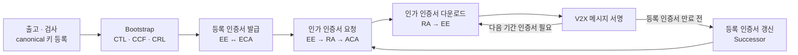

| 단계                 | 상대             | 핵심 API                                             | 결과물                                    | 장  |
| -------------------- | ---------------- | ---------------------------------------------------- | ----------------------------------------- | --- |
| 단말 등록            | DCM 등 (범위 밖) | -                                                    | canonical ID ↔ 공개키 등록                | 4.2 |
| Bootstrap            | RA 또는 DC       | `GET /ctl`, `GET /ccf-ctl`, `GET /composite-crl-ctl` | 신뢰할 Root CA, CA 인증서 체인, 폐기 목록 | 4   |
| 등록 인증서 발급     | ECA              | `POST /enrollment-certificate`                       | 등록 인증서 (즉시 응답)                   | 5   |
| 인가 인증서 요청     | RA → ACA         | `POST /authorization-certificate`                    | Ack (다운로드 시각)                       | 6   |
| 인가 인증서 다운로드 | RA               | `GET /authorization-certificate`                     | 인가 인증서 ZIP                           | 7   |
| 등록 인증서 갱신     | RA → ECA         | `POST`/`GET /successor-enrollment-certificate`       | 새 등록 인증서                            | 8   |

- 등록 인증서는 요청하면 **바로 응답으로** 받는다.
- 인가 인증서와 갱신된 등록 인증서는 **요청 → Ack → 나중에 다운로드** 의 두 단계로 받는다.

**처음 인가 인증서를 받기까지의 메시지 순서** (direct authorization 예시)

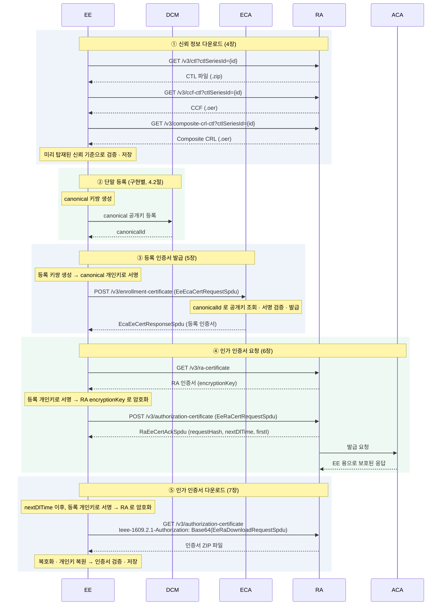

> Ack 는 "요청을 받았다"는 확인일 뿐 **인증서가 아니다**. 인증서는 반드시 ⑤ 다운로드로 받는다.
{: .prompt-tip }

> 📖 **규격 참고** : **4.1.4 Assumed lifecycle and use cases (p.18~23)**, 4.1.4.1 Use case 목록 (p.18)

## 1.4 메시지 구조

### 1.4.1 계층 구조

모든 인터페이스는 아래 4개 층으로 정의된다. 이후 나오는 "검증"들도 어느 층에서 하는 일인지 생각하면 정리가 쉽다.


_인터페이스 계층 구조_

> 📖 **규격 참고** : 4.2 Interface approach, **Figure 3 — Layered approach (p.28)**, Clause 5 Secure session (p.37~), Clause 6 Web API (p.42~)

### 1.4.2 ScmsPdu — 모든 메시지의 뿌리

EE 와 SCMS 가 주고받는 모든 PDU 는 `ScmsPdu { version 2, content CHOICE }` 로 감싼다. `content` 의 선택지가 **어느 인터페이스의 메시지인지**를 나타낸다.

- EE 가 다루는 것은 `eca-ee`, `ee-ra`, `aca-ee`, `cert` 네 가지다.
- 나머지(`aca-la`, `ee-ma` …)는 이 표준에서 `NULL` 로 자리만 잡아 두었다.


_ScmsPdu 구조와 이 글에서 다루는 위치 (오른쪽 태그 = 이 글의 장)_

> 📖 **규격 참고** : **7.3.2 ScmsPdu (p.83~84)**, 7.3.3 AcaEeInterfacePdu (p.84), **7.3.8 CertManagementPdu (p.85)**, 7.3.30 EcaEeInterfacePdu (p.93), **7.3.34 EeRaInterfacePdu (p.95)**, Annex G (AcaRaInterfacePdu)

### 1.4.3 SPDU 포장 패턴

실제로 전송되는 것은 `ScmsPdu` 를 IEEE 1609.2 의 `Ieee1609Dot2Data` 로 서명·암호화한 **SPDU** 다. 포장 방식은 몇 가지 패턴으로 정리된다.


_SPDU 포장 패턴_

- EE 가 RA 로 보내는 요청은 **"등록 인증서로 서명한 뒤 RA 공개키로 암호화"** 가 기본이다.
- 서버가 EE 로 보내는 응답은 보통 **서버 인증서로 서명**한다. 인가 인증서 응답은 RA 에게 숨기기 위해 **EE 용으로 암호화**하기도 한다(2.5절).

> 📖 **규격 참고** : 7.4 Secured protocol data unit structures (p.103~109), 7.5 Parameterized types (p.110~114)

---

# 2. 핵심 개념

## 2.1 등록 인증서와 인가 인증서

EE 가 다루는 인증서는 두 종류다. 비유하면 **SCMS 에 내미는 신분증**과 **도로에서 쓰는 출입증**이다.

| 구분               | 등록 인증서 (Enrollment Certificate)            | 인가 인증서 (Authorization Certificate)  |
| ------------------ | ----------------------------------------------- | ---------------------------------------- |
| 비유               | SCMS 에 내미는 신분증                           | 도로에서 쓰는 출입증                     |
| 발급               | ECA                                             | ACA (RA 가 요청을 승인한 뒤)             |
| 서명 대상          | SCMS 로 보내는 요청 (인가 요청, 다운로드, 갱신) | V2X 애플리케이션 메시지 (BSM 등)         |
| 받는 방법          | 요청 → **즉시 응답** (5장)                      | 요청 → Ack → **나중에 다운로드** (6·7장) |
| 요청에 서명하는 키 | 최초 : canonical 키 등, 갱신 : 현재 등록 인증서 | 등록 인증서 (+ RA 공개키로 암호화)       |
| 종류               | -                                               | **Identification** / **Pseudonym**       |

이 둘에 서버 쪽 **CA 인증서**를 더하면 SCMS 에 등장하는 인증서가 모두 나온다.

| 인증서          | 한 줄 정의                                                                                                |
| --------------- | --------------------------------------------------------------------------------------------------------- |
| **CA 인증서**   | 인증기관(Root CA, ICA, ECA, ACA …)의 신원과 공개키를 확인하고, 인증기관 사이의 신뢰 관계를 만든다 (2.3절) |
| **등록 인증서** | EE 가 인가 인증서를 **요청할 권한**을 나타내며, 발급 요청을 인증하는 데 쓴다                              |
| **인가 인증서** | EE 가 특정 애플리케이션 활동을 **수행할 권한**을 나타낸다                                                 |

> 📖 **규격 참고** : 3.1 Definitions — authorization certificate (p.4), enrollment certificate (p.6), identification / pseudonym certificate (p.6~7), 4.1.1 General (p.11)

### 2.1.1 등록 인증서

> A certificate that is used to request authorization certificates and to manage other interactions between an end entity (EE) and the SCMS. — 3.1 Definitions

- 가장 중요한 용도는 **인가 인증서 요청에 서명**하는 것이다. 다운로드 요청과 갱신 요청에도 쓴다.
- **V2X 메시지 서명에는 쓰지 않는다.**

**들어 있어야 하는 것** (IEEE 1609.2 등록 인증서 프로파일)

| 필드                     | 조건                                                       | 의미                                                                  |
| ------------------------ | ---------------------------------------------------------- | --------------------------------------------------------------------- |
| `appPermissions`         | PSID = **SecurityMgmtPsid(35)**, SSP = **EeSsp** 항목 포함 | "SCMS 와 인증서 관리 통신을 하는 EE"                                  |
| `certRequestPermissions` | 필수. `minChainLength = 0`, `eeType` 에 **app** 포함       | 이 인증서로 **요청할 수 있는 인가 인증서 권한(PSID/SSP)의 최대 범위** |
| `canRequestRollover`     | 갱신(8장)을 하려면 필수                                    | Successor 요청 가능 여부                                              |

- `certRequestPermissions` 가 있고 EE 가 소유한다는 점이 **등록 인증서를 구분하는 기준**이다.
- 형식은 IEEE 1609.2 와 ITU-T X.509 두 가지를 인가 인증서 요청 인증에 쓸 수 있다. 다만 1609.2.1 이 발급·갱신 절차를 정의하는 것은 **IEEE 1609.2 형식뿐**이다.

**RA 와의 관계**

- RA 는 등록 인증서를 **EE 의 대표 식별자**로 쓰고, **자기에게 등록된 등록 인증서**의 요청만 처리한다. 한 EE 가 여러 RA 를 돌며 인증서를 더 받아 가는 것을 막기 위해서다.
- 오동작이 판정된 EE 는 RA 가 등록 인증서를 **blocked** 로 표시한다.
  - 인가 인증서와 갱신 인증서의 요청·다운로드가 거부된다.
  - CRL·CTL 같은 보안 관리 정보는 계속 받을 수 있게 하는 것이 권장된다.

> 📖 **규격 참고** : 4.1.3 Types of enrollment certificate (p.18), **4.1.4.3.1 registration / blocking (p.20)**, **7.6.3.7 Enrollment (IEEE 1609.2) certificate profile (p.120~121)**

### 2.1.2 인가 인증서

> A certificate that is used to authorize application activities. — 3.1 Definitions

- EE 가 V2X 메시지에 서명할 때 쓴다. 수신 측은 인증서의 PSID/SSP 를 보고 "이 송신자에게 이 메시지를 보낼 권한이 있는가"를 판단한다.
- 어떤 PSID/SSP 를 담을지는 애플리케이션마다 달라서 1609.2.1 은 프로파일을 정하지 않는다. 다만 **등록 인증서의 `certRequestPermissions` 범위를 넘을 수 없다.**
- 예전 SCMS 문서의 PCA(Pseudonym CA)가 identification 인증서까지 발급하게 되면서 **ACA** 로 이름이 바뀌었다.

**Identification vs Pseudonym**

| 항목                    | **Identification (식별)**                    | **Pseudonym (가명)**                                                |
| ----------------------- | -------------------------------------------- | ------------------------------------------------------------------- |
| 목적                    | 소유자의 신원을 **일부러 숨기지 않음**       | EE 의 **프라이버시 보호**                                           |
| 동시 유효 장수          | 제한 없음. 발급 방식에 따라 1장 또는 여러 장 | **여러 장이 동시에 유효**. 시간·장소마다 바꿔 써서 추적을 어렵게 함 |
| butterfly key (2.5절)   | 선택                                         | 사용                                                                |
| Linkage value 기반 폐기 | 사용 안 함                                   | 사용. linkage seed 를 CRL 에 올려 한 EE 의 인증서를 한꺼번에 폐기   |
| ACPC (활성화 코드)      | 사용 안 함                                   | 사용 가능. 잠근 채 발급하고, 폐기되지 않은 EE 에게만 해제 코드 배포 |

- Pseudonym 인증서들은 서로 **아무 관계 없는 무작위 값**처럼 보인다. 그래서 인증서 해시로는 한 EE 의 인증서를 묶어 폐기할 수 없고, 비밀 seed 로 연결되는 **linkage value** 를 쓴다(9장).
- 어느 쪽을 요청하는지는 요청 `tbsCert.id` 의 종류로 정해진다. `linkageData` 면 pseudonym 요청이고 ACA 가 실제 linkage value 로 덮어쓴다. 그 밖의 값이면 identification 요청이고 요청한 `id` 가 그대로 인증서에 들어간다.

> 운영 측면(CAMP SCMS)에서는 인가 인증서를 쓰임새에 따라 셋으로 부르기도 한다. 1609.2.1 자체는 identification / pseudonym 두 가지만 정의한다.
>
> | 분류 | 쓰는 곳 | 동시에 유효한 장수 |
> | --- | --- | --- |
> | **Pseudonym** | 이동형 플랫폼(차량)의 V2X 메시지 | 여러 장. 바꿔 가며 써서 추적 가능성을 낮춘다 |
> | **Identification** | 이동형 플랫폼에서 신원이 필요한 애플리케이션 | 보통 1장 |
> | **Application** | 비이동형 플랫폼(RSU 등)의 애플리케이션 | 보통 1장 |
{: .prompt-info }

> 📖 **규격 참고** : 4.1.1 NOTE (PCA → ACA, p.14), **4.1.4.3.2 Authorization certificate request (p.20~21)**, 7.3.35 EeRaCertRequest — `id` 가 linkageData 면 pseudonym (p.96), 7.6.3.3 Authorization certificate profile (p.119), Annex F Linkage value (p.213~)

## 2.2 Explicit 인증서와 Implicit 인증서

### 2.2.1 어떤 인증서가 어떤 형식인가

| 인증서      | 형식                                                                                                                                                                                                         |
| ----------- | ------------------------------------------------------------------------------------------------------------------------------------------------------------------------------------------------------------ |
| 등록 인증서 | **explicit / implicit 둘 다 가능.** EE 가 요청의 `type` 필드로 고르고, 정책에 맞지 않으면 ECA 가 400-34 를 돌려준다                                                                                          |
| 인가 인증서 | 4.1.4.3.2 개요에는 "implicit" 이라고 쓰여 있다. 그러나 요청의 `type`(7.3.35), 응답의 `privateKeyInfo`(7.3.4), butterfly 키 유도(9.3)가 모두 **explicit 도 정의**한다. 즉 구조상 둘 다 가능하고 정책이 정한다 |

실제 운용에서는 인증서가 작은 **implicit** 을 주로 쓴다. 이 글의 그림과 수식도 implicit 기준이다.

### 2.2.2 Implicit 인증서 (ECQV)

Implicit 인증서(SEC 4 ECQV)에는 **공개키 대신 "재구성 값"** 이 들어 있고 CA 의 **서명도 없다**. 그 대신 공개키를 복원하는 과정 자체가 CA 와의 신뢰 연결이 된다.

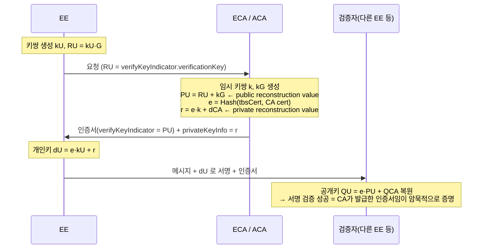

검산 : `dU·G = e·kU·G + e·k·G + dCA·G = e·(RU + kG) + QCA = e·PU + QCA = QU` ✅

| 이름                         | 수식              | 어디에 있나                                     |
| ---------------------------- | ----------------- | ----------------------------------------------- |
| public reconstruction value  | `PU = kG + RU`    | 인증서 `verifyKeyIndicator.reconstructionValue` |
| private reconstruction value | `r = e·k + dCA`   | 응답의 `privateKeyInfo` (32 bytes)              |
| 최종 개인키                  | `dU = e·kU + r`   | EE 내부                                         |
| 최종 공개키                  | `QU = e·PU + QCA` | 검증자가 계산                                   |

`e = Hash( Hash(인증서 tbs) ‖ Hash(발급 CA 인증서) )` 이다.

### 2.2.3 EE 가 응답을 받았을 때 키 처리

5장(등록 인증서)과 7장(인가 인증서)의 응답 처리에서 공통으로 쓰는 표다.

|             | Explicit 인증서                            | Implicit 인증서                                 |
| ----------- | ------------------------------------------ | ----------------------------------------------- |
| 공개키      | 인증서 `verifyKeyIndicator` 에서 바로 추출 | 재구성 값 `PU` 추출 → `QU = e·PU + QCA` 로 복원 |
| 인증서 신뢰 | 인증서의 **CA 서명 검증**                  | 서명 없음. 복원 과정 자체가 CA 와의 연결        |
| 개인키      | 요청 때 만든 개인키 그대로                 | `dU = e·kU + r`                                 |
| 키쌍 확인   | 공개키 = 내 개인키 × G ?                   | **`dU·G == QU` ?**                              |

키쌍이 맞지 않으면 올바르게 발급되지 않은 인증서이므로 쓰지 않는다.

> 📖 **규격 참고** : 4.1.4.3.2 implicit 인증서 설명 (p.20), **7.3.31 EeEcaCertRequest.type / NOTE 2 (p.94)**, 7.3.35 EeRaCertRequest.type (p.96), 7.3.4 AcaEeCertResponse.privateKeyInfo (p.85), 7.3.32 EcaEeCertResponse.privateKeyInfo (p.95), 9.3.1.4 explicit / implicit 별 butterfly 유도 (p.134), **8.2.4.2 Correspondence between private key and public key (p.124)**, 2. Normative references – SEC 4 (p.3). 계산 상세는 IEEE 1609.2 5.3.1 · 5.3.2 를 따른다.

## 2.3 SCMS 의 신뢰 구조

EE 가 서버의 서명을 믿을 수 있는 이유는 **위에서 아래로 만들어지고, 아래에서 위로 검증되는** 인증서 사슬 덕분이다.

| 인증서              | 언제 만들어지나                        | 누가 서명하나                          | EE 는 어떻게 얻나                         |
| ------------------- | -------------------------------------- | -------------------------------------- | ----------------------------------------- |
| Elector             | SCMS 구축 시                           | 자기 자신                              | 출고 시 탑재된 첫 CTL, 이후 CTL           |
| Root CA             | SCMS 구축 시                           | 자기 자신 (+ Elector 들이 CTL 로 승인) | CCF                                       |
| ICA                 | Root 생성 뒤                           | Root CA                                | CCF                                       |
| ECA · ACA · RA · MA | 각 서버를 구성할 때, 만료 전 교체할 때 | ICA (구성에 따라 Root)                 | CCF, `ra-certificate`, 응답의 인증서 체인 |
| 등록 · 인가 인증서  | **EE 가 요청할 때**                    | ECA / ACA                              | 5~8장                                     |

- 서버 인증서는 **SCMS 가 미리** 만들어 두고, EE 인증서만 **요청할 때** 만들어진다.
- 서버 개인키는 각 서버 안에서 만들어지고, 상위 CA 는 공개키에 서명해 인증서를 돌려줄 뿐이다. CA 끼리의 발급 절차는 1609.2.1 의 범위 밖이다.
- 서버 인증서가 교체되면 RA 가 새 CCF 를 배포하고, EE 는 정보 상태 확인(4.7절)으로 이를 알아챈다.
- 서버 인증서는 PSID 35 와 역할별 SSP(`EcaSsp`, `AcaSsp`, `RaSsp` …)로 역할을 표시한다. RA 인증서에는 EE 가 요청을 암호화할 `encryptionKey` 가 반드시 있다.

EE 는 이 사슬을 검증하기 위해 세 가지 **신뢰 정보**를 내려받는다(4장).

| 신뢰 정보                             | 무엇인가                                                   | 답해 주는 질문                                 |
| ------------------------------------- | ---------------------------------------------------------- | ---------------------------------------------- |
| **CTL** (Certificate Trust List)      | Elector 들이 서명한, 신뢰할 **Root CA 와 Elector 의 목록** | "어느 Root CA 를 믿을까?"                      |
| **CCF** (Certificate Chain File)      | CTL 과 **CA·MA 등의 인증서**를 함께 담은 파일              | "이 서버 인증서는 믿을 만한 Root 로 이어지나?" |
| **CRL** (Certificate Revocation List) | 폐기된 인증서를 해시나 linkage 값으로 알려 주는 목록       | "이 인증서는 아직 유효한가?"                   |

> 📖 **규격 참고** : 4.1.1 root of trust (p.12~13), 7.6.2 SecurityMgmtSsp (p.114~116), **7.6.3 인증서 프로파일 — ACA 7.6.3.2 (p.119), ECA 7.6.3.5 (p.120), Elector 7.6.3.6 (p.120), MA 7.6.3.9 (p.121), RA 7.6.3.10 (p.121~122)**, 7.6.3.1 Root CA 는 자기 서명, ICA 프로파일은 범위 밖 (p.119)

## 2.4 Canonical 키 : 처음 등록할 자격 증명

인증서가 하나도 없는 EE 가 "나는 SCMS 에 등록된 진짜 장치다"를 보여 주는 수단이다.

| 용어                 | 정체                                                                                               | 비유                 |
| -------------------- | -------------------------------------------------------------------------------------------------- | -------------------- |
| **canonical 키쌍**   | 장치가 만드는 **수명이 긴 장치 키**                                                                | 도장                 |
| **canonical 공개키** | 장치 검사를 통과하면 SCMS 데이터 저장소에 등록된다                                                 | 관공서에 등록한 인감 |
| **canonical 개인키** | 장치 안에 두고 등록 인증서 요청에 서명한다                                                         | 내가 가진 도장       |
| **canonical ID**     | 전 세계에서 하나뿐인 장치 식별자. 저장소에서 공개키를 찾는 열쇠. 요청의 `canonicalId`(`IA5String`) | 인감 등록 번호       |

**두 가지 등록 자격 방식**

| 방식                                                   | 요청 서명 키                  | `canonicalId` | 자격 확인 방법                                  |
| ------------------------------------------------------ | ----------------------------- | ------------- | ----------------------------------------------- |
| **direct authorization** (`scmsV3-eeAuth = canonical`) | canonical 개인키              | **포함**      | ECA 가 `canonicalId` 로 공개키를 찾아 서명 검증 |
| **indirect authorization**                             | 새로 만든 등록 키 (자기 서명) | **생략**      | 물리 보안 환경, OAuth 등 **요청 바깥의 수단**   |

- canonical 키는 **최초 등록 인증서 요청에만** 쓴다. 갱신 요청(8장)에는 `canonicalId` 를 넣으면 안 된다.
- 등록 인증서의 키는 canonical 키와 **별개로 새로 만든 키**다. canonical 키는 "자격 증명용", 등록 인증서 키는 "SCMS 와 통신용"이다.
- ECA 는 *canonical key acceptance policy* 에 따라 키 알고리즘, 키를 만든 하드웨어의 보안 수준 등을 보고 그 canonical 키를 인정할지 정할 수 있다.

> 📖 **규격 참고** : **3.1 Definitions — canonical identifier, canonical key, canonical key acceptance policy (p.4)**, **4.1.4.2 direct / indirect authorization (p.19)**, 7.3.31 EeEcaCertRequest.canonicalId (p.93~94), 7.4.10 EeEcaCertRequestSpdu 서명 키 (p.106), 6.3.5.4.2 갱신 요청에서 canonicalId 금지 (p.60)

## 2.5 Butterfly key 와 5가지 발급 방식

### 2.5.1 Butterfly key 란

Pseudonym 인증서는 한 번에 수십 장이 필요하다. 그런데 장마다 키쌍을 만들어 보내면 요청이 커지고, 인증서끼리 같은 EE 의 것임이 드러날 수 있다. **butterfly key** 는 **키쌍 하나와 확장 함수 하나**만 보내서 서로 무관해 보이는 키 여러 개를 만들어 내는 방법이다.

| 단계        | 누가          | 무엇을                                                                                      | 수식 (서명용)                                    |
| ----------- | ------------- | ------------------------------------------------------------------------------------------- | ------------------------------------------------ |
| caterpillar | EE            | 키쌍 `(a, A = aG)` 와 확장 함수 키 `kS` 를 만들어 요청에 넣는다                             | -                                                |
| cocoon      | SCMS (확장기) | (i, j) 마다 cocoon 공개키를 만든다                                                          | `B(i,j) = A + fS(kS, i, j)·G`                    |
| butterfly   | ACA           | cocoon 공개키에 무작위 값을 섞어 인증서를 만든다. implicit 인증서 생성이 이 단계를 대신한다 | `PU = B(i,j) + kG`                               |
| 개인키 복원 | EE            | 같은 i, j 로 cocoon 개인키를 계산해 ECQV 의 `kU` 자리에 넣는다                              | `b(i,j) = a + fS(kS, i, j)`, `dU = e·b(i,j) + r` |

- `i` 는 기간(i-period, 보통 주 단위), `j` 는 그 기간 안의 인증서 번호다.
- 확장 함수 키(`ButterflyExpansion`)는 `aes128` 16바이트 키다.
- 암호화용도 같은 방식이다 : `Q(i,j) = P + fE(kE, i, j)·G`, `q(i,j) = p + fE(kE, i, j)`. 암호화는 입력을 `xE = 1^32 ‖ i ‖ j ‖ 0^32` 로 바꿔 계산한다.


_Butterfly 확장 함수 fS_

- 규격의 SPDU 는 **cocoon 확장은 RA, 인증서 생성은 ACA** 가 하는 구성(Figure 12)을 기준으로 정의되어 있다. 이렇게 나누면 RA 는 최종 인증서를 모르고, ACA 는 어느 인증서들이 같은 EE 의 것인지 모른다(**SCMS 내부자에 대한 프라이버시**).
- 내부자 프라이버시가 덜 중요하면 두 단계를 모두 ACA 에서 해도 된다(Figure 13·14).

**누가 무엇을 알고 무엇을 모르나** (original 방식, implicit, Figure 12 구성)

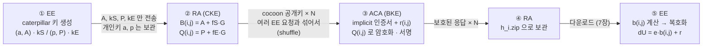

| 단계  | 아는 것                                     | 모르는 것                                                                                                              |
| ----- | ------------------------------------------- | ---------------------------------------------------------------------------------------------------------------------- |
| ② RA  | 어떤 cocoon 키·응답이 **같은 EE** 의 것인지 | 응답이 암호화돼 있어 **인증서 내용**을 모른다                                                                          |
| ③ ACA | 발급한 인증서 내용                          | RA 가 여러 EE 의 요청을 섞어 보내고 `j` 같은 묶음 정보도 넘기지 않으므로, **어느 인증서들이 같은 EE 의 것인지** 모른다 |
| ③ ACA | `r(i,j)` (개인키 복원 기여값)               | caterpillar 개인키 `a` 를 모르므로 **최종 개인키 `dU` 를 만들 수도 가질 수도 없다**                                    |
| ⑤ EE  | 모든 것                                     | -                                                                                                                      |

> 📖 **규격 참고** : **9.2.1 Butterfly keys / Figure 9 (p.127~128)**, Figure 10·11 (p.129~130), **9.2.2 / Figure 12~14 — 확장기 배치 (p.131)**, 9.2.3 implicit 생성이 butterfly 단계를 대체 (p.131), **9.2.4 Privacy against insiders (p.132)**, F.2 NOTE 1·2 — RA 의 shuffle (p.214), F.3 누가 무엇을 아는가 (p.215), **9.3.3.1 Butterfly expansion functions, xE (p.135)**, 9.3.4 Cocoon key derivation (p.136~137), 9.3.5.1 butterfly 개인키 (p.137), 4.3.2 i-period (p.28~33)

### 2.5.2 5가지 발급 방식은 언제 쓰나

인가 인증서 요청의 `EeRaCertRequest.additionalParams` 로 발급 방식을 고른다. 고르는 기준은 **질문 세 개**다.

1. **RA 에게 인증서를 숨겨야 하나?** ACA 의 응답은 RA 를 거쳐 EE 에 전달된다. 암호화하지 않으면 RA 는 "이 요청자 = 이 인증서" 를 알게 된다.
2. **인증서를 한 번에 여러 장 받아야 하나?** 그렇다면 butterfly 를 쓴다.
3. **butterfly 라면 얼마나 가볍게 할까?** 서명키와 암호화키를 따로 둘지, ACA 응답 서명까지 뺄지를 고른다.

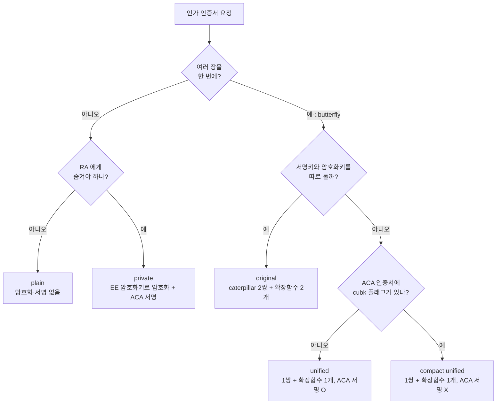

| 방식                | `additionalParams`                                                  | 언제 쓰나                                                               | 특징                                                                                                                          |
| ------------------- | ------------------------------------------------------------------- | ----------------------------------------------------------------------- | ----------------------------------------------------------------------------------------------------------------------------- |
| **plain**           | 없음                                                                | RA 에게 프라이버시를 지킬 필요가 없을 때. 예 : pseudonym 이 아닌 인증서 | 응답이 암호화도 서명도 없다. 가장 단순하다                                                                                    |
| **private**         | `encryptionKey`                                                     | 1장이지만 RA 에게 숨기고 싶을 때                                        | EE 가 준 암호화키로 암호화하고 ACA 가 서명한다. ACA 서명은 "EE 가 지정한 키로 암호화했다"를 보증해 RA 의 키 바꿔치기를 막는다 |
| **original**        | `original { signingExpansion, encryptionKey, encryptionExpansion }` | 여러 장이 필요할 때의 기본형                                            | 서명용과 암호화용 caterpillar 키·확장 함수를 **따로** 보낸다                                                                  |
| **unified**         | `unified (확장 함수)`                                               | butterfly 를 쓰되 요청 크기와 EE 계산량을 줄이고 싶을 때                | 키·확장 함수를 **하나로** 서명·암호화에 함께 쓴다. ACA 는 "암호화키 = 인증서 검증키" 인지 직접 확인할 수 있다                 |
| **compact unified** | `compactUnified (확장 함수)`                                        | unified 에서 응답 크기와 처리량을 더 줄이고 싶을 때                     | ACA 응답 **서명을 뺀다**. 대신 ACA 인증서에 `cubk` 플래그가 있어야 한다                                                       |

- butterfly 를 쓰면 `tbsCert.verifyKeyIndicator` 가 **caterpillar 서명 공개키 A** 역할을 한다.
- **compact unified 에서 서명이 없어도 되는 이유** : unified 계열에서는 암호화키가 곧 인증서 검증키다. RA 가 암호화키를 바꿔치기하면 인증서의 키도 함께 바뀌고, EE 가 복원한 개인키와 맞지 않아 들킨다. `cubk` 플래그는 "이 ACA 는 항상 unified 로 발급한다"는 뜻이다.

> 정리하면 **plain ↔ private** 는 "숨길까 말까", **private ↔ butterfly** 는 "1장이냐 여러 장이냐", **original → unified → compact unified** 는 "같은 보안을 얼마나 가볍게 하느냐"의 차이다.
{: .prompt-info }

### 2.5.3 방식별 키 정리

방식에 따라 각 단계에서 쓰는 키가 달라진다. 6·7장에서는 이 표를 가리킨다.

| 방식            | 받는 인증서 | 응답 암호화 공개키 (ACA)           | 응답 복호화 개인키 (EE)   | ECQV 의 `kU` 자리 (EE)        | ACA 응답 서명          | RA 가 인증서를 볼 수 있나 |
| --------------- | ----------- | ---------------------------------- | ------------------------- | ----------------------------- | ---------------------- | ------------------------- |
| plain           | 1장         | -                                  | -                         | 요청 때 만든 서명 개인키 `kU` | X                      | **볼 수 있음**            |
| private         | 1장         | `additionalParams.encryptionKey`   | 그 공개키의 개인키        | 서명 개인키 `kU`              | O                      | 못 봄                     |
| original        | 여러 장     | `Q(i,j) = P + fE(kE,i,j)·G`        | `q(i,j) = p + fE(kE,i,j)` | `b(i,j) = a + fS(kS,i,j)`     | O                      | 못 봄                     |
| unified         | 여러 장     | `B(i,j)` (서명용 cocoon 키와 같음) | `b(i,j)`                  | `b(i,j)`                      | O                      | 못 봄                     |
| compact unified | 여러 장     | `B(i,j)`                           | `b(i,j)`                  | `b(i,j)`                      | **X** (`cubk` 로 대신) | 못 봄                     |

- 응답 암호화에는 butterfly 형태가 아니라 **cocoon 키 그대로**를 쓴다.
- EE 는 요청 뒤에도 **caterpillar 개인키와 확장 함수 키**(plain·private 라면 서명·암호화 개인키)를 보관해야 한다. 하나라도 잃으면 다운로드한 인증서를 풀거나 쓸 수 없다.

> 📖 **규격 참고** : **7.3.35 EeRaCertRequest (p.96~97)**, **7.3.36 AdditionalParams (p.97~98)**, 7.3.37 ButterflyParamsOriginal (p.98), 7.3.38 ButterflyExpansion (p.98), **7.4.3 plain 을 쓰는 경우 (p.103)**, 7.4.4 암호화 키 결정 규칙 (p.103~105), **9.2.5 Types of butterfly keys (p.132)**, **9.3.4.1 Cocoon private key derivation (p.136)**, **9.3.6.1 세 butterfly 방식의 차이 (p.138)**, 9.3.6.2~9.3.6.5 방식별 요청·응답 규칙과 cubk 검사 (p.138~140), G.3 RaAcaCertRequest.certEncKey / flags.cubk (p.218)

## 2.6 ECIES 암호화 (v, c, t)

이 글의 모든 암호화(EE → RA 요청, ACA → EE 응답)는 같은 구조를 쓴다.

```
EncryptedData
 ├─ recipients : 받는 사람별로 "대칭키를 공개키로 잠근 것"
 │    └─ certRecipInfo / rekRecipInfo
 │         ├─ recipientId : 받는 사람 키 식별자 (HashedId8)
 │         └─ encKey : eciesNistP256 { v, c, t }
 └─ ciphertext : 본문을 대칭키(AES-128-CCM)로 암호화한 것 { nonce, ccmCiphertext }
```

본문은 빠른 **대칭키 K** 로 암호화하고, 그 K 를 받는 사람의 **공개키로 잠가서** 함께 보낸다. **v, c, t** 는 이 "잠긴 대칭키 꾸러미"를 이루는 세 값이다.

| 값    | 이름            | 크기          | 무엇인가                                                          | 왜 필요한가                                                             |
| ----- | --------------- | ------------- | ----------------------------------------------------------------- | ----------------------------------------------------------------------- |
| **v** | 임시 공개키     | 33B (압축 점) | 보내는 쪽이 **암호화할 때마다 새로 만든** 키쌍의 공개키 `v = u·G` | 받는 쪽이 자기 개인키와 v 로 ECDH 를 해서 **같은 공유 비밀값**을 얻는다 |
| **c** | 암호화된 대칭키 | 16B           | 대칭키 K 를 KDF 출력 `ke` 로 가린 값 (`c = K ⊕ ke`)               | 받는 쪽이 `ke` 를 다시 만들어 `K = c ⊕ ke` 로 복원한다                  |
| **t** | 인증 태그       | 16B           | `HMAC-SHA256(km, c)` 의 앞 16바이트                               | c 가 위·변조되지 않았고 올바른 키로 만들어졌는지 확인한다               |

| 보내는 쪽                                 | 받는 쪽                                 |
| ----------------------------------------- | --------------------------------------- |
| 1. 임시 키쌍 `(u, v = u·G)` 생성          | 1. `S = (내 개인키) · v`                |
| 2. `S = u · (받는 쪽 공개키)`             | 2. 같은 KDF 로 `ke`, `km`               |
| 3. KDF2(SHA-256) 로 `ke`(16B), `km`(32B)  | 3. `HMAC(km, c) == t` 확인. 다르면 거부 |
| 4. `c = K ⊕ ke`, `t = HMAC(km, c)` 앞 16B | 4. `K = c ⊕ ke`                         |
| 5. K 로 본문 AES-CCM 암호화, `u` 는 버림  | 5. K 와 `nonce` 로 본문 AES-CCM 복호화  |


_받는 쪽의 복호화 (예 : EE 가 ACA 의 응답을 푸는 경우)_

- KDF 의 파라미터 P1 에는 받는 사람 인증서의 해시(SHA-256)를 넣는다. 그래서 꾸러미가 그 인증서에 묶인다. `rekRecipInfo` 처럼 인증서가 없으면 빈 문자열의 해시를 쓴다.
- v 는 매번 새로 만들기 때문에, 같은 상대에게 보내도 꾸러미는 매번 다르다.

> **비유** : 본문은 금고(AES)에 넣고, 금고 열쇠 K 는 봉투에 넣어 보낸다. **v** 는 봉투를 여는 데 필요한 "보낸 사람 쪽 절반의 정보", **c** 는 봉투 안의 잠긴 열쇠, **t** 는 봉인 스티커다.
{: .prompt-tip }

> 📖 **규격 참고** : 7.5.6~7.5.7 SignedEncrypted 파라미터 타입 (p.112). ECIES 와 v/c/t 는 1609.2.1 이 아니라 **IEEE 1609.2** 에 정의되어 있다 : 5.3.5 ECIES (KDF2 · HMAC-SHA256 · 태그 128비트), `EncryptedData` / `RecipientInfo` / `PKRecipientInfo` / `EciesP256EncryptedKey`.

---

# 3. 공통 규칙

## 3.1 REST API

```
https://{server}:443/v3/{resource}?{query-parameters}
Content-Type: application/octet-stream     (본문은 C-OER 인코딩된 SPDU)
```

EE 가 쓰는 API 전체 목록이다. **굵게** 표시한 것을 이 글에서 자세히 다룬다.

| 인터페이스 | Method | Path                                        | 요청 Body                              | 응답 Body                                  | 규격     | 이 글 |
| ---------- | ------ | ------------------------------------------- | -------------------------------------- | ------------------------------------------ | -------- | ----- |
| ECA–EE     | POST   | **`enrollment-certificate`**                | EeEcaCertRequestSpdu                   | EcaEeCertResponseSpdu                      | Table 9  | 5장   |
| EE–RA      | POST   | **`authorization-certificate`**             | EeRaCertRequestSpdu                    | RaEeCertAckSpdu                            | Table 10 | 6장   |
| EE–RA      | GET    | **`authorization-certificate`**             | (헤더로 전달)                          | ZIP 파일                                   | Table 11 | 7장   |
| EE–RA      | GET    | `authorization-certificate?filename=…`      | -                                      | ZIP 파일                                   | Table 12 | 7장   |
| EE–RA      | POST   | **`successor-enrollment-certificate`**      | EeRaSuccessorEnrollmentCertRequestSpdu | RaEeEnrollmentCertAckSpdu                  | Table 13 | 8장   |
| EE–RA      | GET    | **`successor-enrollment-certificate`**      | (헤더로 전달)                          | `h_enroll.oer` 파일                        | Table 14 | 8장   |
| EE–RA      | POST   | `misbehavior-report`                        | 오동작 신고 (PDU 는 범위 밖)           | -                                          | 6.3.5.6  | 9장   |
| EE–RA      | GET    | **`ccf-ctl?ctlSeriesId=…`**                 | -                                      | CertificateChainSpdu                       | Table 15 | 4장   |
| EE–RA      | GET    | **`composite-crl-ctl?ctlSeriesId=…`**       | -                                      | CompositeCrlSpdu                           | Table 16 | 4장   |
| EE–RA      | GET    | `ca-certificate?certId=[HashedId8]`         | -                                      | Certificate                                | Table 17 | -     |
| EE–RA      | GET    | **`crl?craca=…&crlSeries=…`**               | -                                      | SecuredCrl                                 | Table 18 | 4장   |
| EE–RA      | GET    | **`ctl?ctlSeriesId=…&ctlSequenceNumber=…`** | -                                      | MultiSignedCtlSpdu 묶음 (ZIP)              | Table 19 | 4장   |
| EE–RA      | GET    | **`ra-certificate`**                        | -                                      | RA 인증서                                  | Table 20 | 6장   |
| EE–RA      | GET    | `ma-certificate?psid=…`                     | -                                      | MA 인증서                                  | Table 21 | -     |
| EE–RA      | GET    | **`certificate-management-info-status`**    | -                                      | CertificateManagementInformationStatusSpdu | Table 22 | 4장   |

- `ccf-ctl` · `composite-crl-ctl` · `ca-certificate` · `crl` · `ctl` · `certificate-management-info-status` 는 **DC** 도 같은 형태로 제공한다(DC–EE).
- 쿼리의 `ctlSeriesId` 는 8바이트 값을 **16자리 hex** 로 쓴다 (예: `0123456789ABCDEF`, 대소문자 무관).
- GET 요청에 서명이 필요하면 SPDU 를 `Ieee-1609.2.1-Authorization` 헤더에 **Base64**(줄바꿈 없음)로 싣는다.

> 📖 **규격 참고** : 6.3.1.2 Conventions (p.46), 6.3.1.4 Custom HTTP headers (p.47), Table 9 (p.51), Table 10 (p.54), Table 11 (p.57), Table 12 (p.59), **Table 13~22 (p.61~78)**, 6.3.5.7.1 ctlSeriesId 인코딩 (p.64)

## 3.2 인증 파라미터 (eeAuth)

EE 인증은 여러 층에서 할 수 있고, 어느 층에서 할지는 파라미터로 표현한다. 이 글의 절차는 주로 **SCMS REST v3 층**(SPDU 서명)의 인증을 다룬다.

| 층           | 파라미터         | 값                                                                 |
| ------------ | ---------------- | ------------------------------------------------------------------ |
| Session      | `session-eeAuth` | `none`, `physical`, `iso21177-enrollment`, `tls1.3-x.509` …        |
| Web API      | `webApi-eeAuth`  | `none`, `oAuth2.0` (`Authorization: Bearer {AT}`)                  |
| SCMS REST v3 | `scmsV3-eeAuth`  | `none`, **`canonical`**, **`enrollment`**, `authorization`, `x509` |

> 📖 **규격 참고** : 4.3.3 Table 2 (p.34), 4.3.4 Table 3 (p.34), 4.3.5 Table 4 (p.35), 6.3.1.3 Protocol parameters (p.46)

## 3.3 에러 응답

### 3.3.1 에러 응답의 구조

에러 응답은 **HTTP 상태 코드(큰 분류) + 상세 에러 코드(응답 헤더)** 의 두 부분으로 이루어진다.

```http
HTTP/1.1 400 Bad Request
Ieee-1609.2.1-Error: 400-31
```

| `scmsV3-error` | 서버가 돌려주는 것                                                                   |
| -------------- | ------------------------------------------------------------------------------------ |
| `fine`         | 아래 상태 코드 중 하나. 400·403 이면 `Ieee-1609.2.1-Error` 헤더에 상세 코드를 넣는다 |
| `coarse`       | 상세 정보 없이 **항상 500** (공격자에게 단서를 주지 않으려는 설정)                   |

### 3.3.2 HTTP 상태 코드

모든 API 가 같은 틀을 쓴다. 재시도 규칙의 `*` 자리는 API 에 따라 `eca-` / `ra-` / `download-` 가 들어간다.

| 상태                      | 의미                                                                                              | EE 가 할 일                                     |
| ------------------------- | ------------------------------------------------------------------------------------------------- | ----------------------------------------------- |
| 400 Bad Request           | 요청 내용 문제                                                                                    | 헤더의 상세 코드 확인 (3.3.3)                   |
| 401 Unauthorized          | 인증 수단이 받아들여지지 않음 (OAuth 토큰, canonical 인증 실패, SPDU 수준 인증 실패 등)           | 인증 수단 확인                                  |
| 403 Forbidden             | 권한 문제                                                                                         | 헤더의 상세 코드 확인                           |
| 404 Not Found             | 해당 URL 의 자원이 없음. 다운로드에서는 `requestHash`·i 가 틀렸거나 **아직 파일이 만들어지기 전** | 이름 확인 또는 나중에 재시도                    |
| 405 Method Not Allowed    | 메서드가 틀림                                                                                     | 올바른 메서드(GET/POST)로 재시도                |
| 408 Request Timeout       | 시간 초과                                                                                         | `*-minWait` 뒤에 최대 `*-maxReqs` 번까지 재시도 |
| 416 Range Not Satisfiable | 다운로드 API 에서 HTTP Range 를 처리할 수 없음                                                    | Range 없이 재시도                               |
| 429 Too Many Requests     | 요청 과다                                                                                         | 빈도 줄이기                                     |
| 500 Internal Server Error | 서버 오류 (`coarse` 면 모든 에러)                                                                 | -                                               |
| 503 Service Unavailable   | 일시적으로 사용 불가                                                                              | `*-minWait` 뒤에 최대 `*-maxReqs` 번까지 재시도 |

- 404 와 416 은 상세 코드 없이 상태 코드만 돌려준다.
- 공개 정보 다운로드 API(CTL·CCF·CRL 등)의 상세 코드는 **400-81 wrong RA** 하나뿐이다.

### 3.3.3 상세 에러 코드 (`Ieee-1609.2.1-Error` 헤더)

상세 코드는 `ddd-dd` 형식이다. 앞 세 자리는 함께 돌려준 HTTP 상태, 뒤는 원인 번호다.

| 시리즈 | 의미                              | 대표 코드                                                                                                                                                     |
| ------ | --------------------------------- | ------------------------------------------------------------------------------------------------------------------------------------------------------------- |
| 400-1x | 암호화 누락                       | 400-10                                                                                                                                                        |
| 400-2x | 등록 인증서 상태                  | 400-20 blocked, 400-21 unregistered                                                                                                                           |
| 400-3x | 허용되지 않은 요청 값 (정책 위반) | 400-30 appPermissions, 400-31 certRequestPermissions, 400-32 기타 필드, 400-33 region, 400-34 type, 400-35 validityPeriod, 400-36 인증서 식별자               |
| 400-4x | 처리 실패                         | 400-40 체인 검증, 400-41 복호화, 400-42 파싱, 400-43 서명 검증                                                                                                |
| 400-5x | 미래 시간                         | 400-50 future generationTime                                                                                                                                  |
| 400-6x | 잘못된(invalid) 값                | 400-60 appPermissions, 400-61 certRequestPermissions, 400-62 enrollment cert, 400-63 region, 400-64 verifyKeyIndicator, 400-65 canonical id, 400-66 기타 필드 |
| 400-7x | 시간·빈도 제한                    | 400-70~73 (eca-), 400-74~76 (download-), 400-77~79, 400-711~712 (ra-)                                                                                         |
| 400-8x | 엉뚱한 서버                       | 400-80 wrong ECA, 400-81 wrong RA                                                                                                                             |

> 규격의 API 표(Table 9, 10 등)에는 "403-43", "403-711" 처럼 Table 8 의 정의(400-43, 400-712)와 다르게 적힌 곳이 있다(D3 초안의 표기 불일치). 이 글은 **Table 8 기준**으로 적는다. 구현할 때는 어느 쪽으로 통일할지 정해 두는 것이 좋다.
{: .prompt-warning }

- "disallowed(3x)" 는 형식은 맞지만 **정책상 허용되지 않는** 값, "invalid(6x)" 는 **값 자체가 잘못된** 경우다.

> 📖 **규격 참고** : 6.3.1.4 Custom HTTP headers (p.47), 6.3.1.5 / **Table 8 — Error codes (p.48~49)**, 각 API 표의 Errors · HTTP response header 행 — 예 : Table 9 (p.51~52), Table 11 (p.57), **Table 18 (p.70)**, Table 19 (p.73)

## 3.4 시간·빈도 제한 파라미터

서버가 요청을 걸러 내는 기준이다. 구체적인 값은 규격이 아니라 **운영 정책**이 정한다.

| 파라미터                         | 의미                                                           | 관련 에러                |
| -------------------------------- | -------------------------------------------------------------- | ------------------------ |
| `eca-maxReqs` / `ra-maxReqs`     | 7×24시간 동안 최대 요청 수                                     | 400-71 / 400-79          |
| `eca-minWait` / `ra-minWait`     | 재요청까지 최소 대기 시간                                      | 400-73 / 400-711         |
| `download-maxReqs`               | 7×24시간 동안 최대 다운로드 수                                 | 400-75                   |
| `download-minWait`               | 다운로드 재시도 최소 대기 시간                                 | 400-76                   |
| `*-maxAge`                       | `generationTime` 이 얼마나 과거여도 되는가                     | 400-70 / 400-74 / 400-77 |
| `eca-maxWait` / `ra-maxGenDelay` | `generationTime` 과 요청한 `validityPeriod.start` 의 최대 차이 | 400-72 / 400-78          |

> 📖 **규격 참고** : 4.3.6 Use case related parameters, **Table 5 (ECA, p.35)**, **Table 6 (RA, p.36)**, **Table 7 (Download, p.37)**

## 3.5 서버의 요청 처리 순서

ECA·RA 가 EE 의 요청을 받으면 모든 API 에서 같은 순서로 처리한다. 5~8장에서는 **각 API 에서 달라지는 부분만** 적는다.

| 순서              | 할 일                                                                                                       | 대표 에러                              |
| ----------------- | ----------------------------------------------------------------------------------------------------------- | -------------------------------------- |
| ① 해시            | 받은 SPDU 전체를 해시해 `requestHash`(HashedId8)를 만든다. 응답에 넣어 "어느 요청에 대한 응답인지"를 묶는다 | -                                      |
| ② 빈도 제한       | 디코드 전에 값싸게 거른다 : 최근 7일 요청 수, 직전 요청과의 간격                                            | `*-maxReqs`, `*-minWait` (3.4절)       |
| ③ 복호화 · 디코드 | 암호화돼 있으면 서버 암호화 개인키로 푼다(2.6절). 그다음 서명 구조와 본문을 디코드한다                      | 400-10, 400-41, 400-42                 |
| ④ 검증            | 서명자 인증서 상태(등록·차단·체인), 서명, 시간, 정책(지역·타입·유효기간·권한)                               | 400-2x, 400-3x, 400-4x, 400-5x, 400-7x |
| ⑤ 처리            | 인증서 발급, Ack 또는 파일 응답                                                                             | -                                      |

- `requestHash` 는 서명을 *canonicalize 하지 않은* SPDU 그대로 해시한다.
- EE 쪽에서도 응답의 `requestHash` 가 **내가 보낸 SPDU 의 해시와 같은지** 항상 확인한다.

> 📖 **규격 참고** : Table 9 HTTP response body — requestHash (p.51), 10.1.2 Common validity conditions (p.155~156)

---

# 4. Bootstrap

## 4.1 개요

EE 가 SCMS 와 처음 통신하기 전에 거치는 **신뢰 수립 절차**다. 장치를 SCMS 에 등록하고, 어떤 인증서를 믿을지 판단할 **신뢰 앵커**를 갖춘다.


_Bootstrap 순서와 신뢰 연결_

| 단계                          | 받는 것                                 | 왜 필요한가                                                 |
| ----------------------------- | --------------------------------------- | ----------------------------------------------------------- |
| 단말 등록                     | - (canonical 정보 등록)                 | ECA 가 "등록 인증서를 받을 자격이 있는 장치"인지 알 수 있게 |
| CTL                           | 신뢰할 **Root CA · Elector** 목록       | 어떤 Root CA 를 믿을지 결정                                 |
| CCF                           | Root CA ~ ECA/ACA/RA/MA **인증서 체인** | 서버들이 보낸 서명을 검증할 공개키 확보                     |
| Composite CRL (또는 개별 CRL) | 폐기 목록                               | 받은 인증서가 폐기되지 않았는지 확인                        |

- 이 정보들은 **RA 또는 DC** 에서 같은 API 로 받는다(1.2절의 DC–EE).
- CRL 과 CA 인증서는 각각 **묶음 파일(Composite CRL, CCF)이 기본**이고, 하나만 필요할 때 쓰는 개별 다운로드 API(`crl`, `ca-certificate`)도 있다.

> 규격은 "EE 가 SCMS 와 안전하게 통신하려면 먼저 **신뢰의 근원(root of trust)** 을 갖춰야 한다"고만 하고, 처음에 무엇을 어떻게 탑재할지는 **범위 밖**으로 둔다. 보통 첫 CTL(또는 Elector·Root CA 인증서)은 공장 출고 시 안전하게 넣어 둔다.
{: .prompt-info }

> 📖 **규격 참고** : 3.1 DCM 정의 (p.5), **4.1.1 DCM · root of trust (p.12~13)**, 4.1.4.1 g) security management 다운로드 (p.18), 4.1.4.3.1 차단된 EE 도 보안 관리 정보는 받도록 허용 (p.20)

## 4.2 단말 등록

- EE 가 **canonical 키쌍을 만들고**, `canonical ID ↔ canonical 공개키` 쌍을 ECA 가 조회할 수 있는 저장소에 등록한다(개념은 2.4절).
- ECA 는 나중에 등록 인증서 요청의 `canonicalId` 로 이 공개키를 찾아 서명을 검증한다.

> IEEE 1609.2.1 은 단말 등록 인터페이스를 **정의하지 않는다**. DCM 같은 등록 서버의 사양도 범위 밖이라 구현마다 다르다.
{: .prompt-warning }

> 📖 **규격 참고** : 3.1 canonical key / DCM 정의 (p.4~5), **4.1.4.2 direct authorization (p.19)**, 4.1.1 DCM 사용 여부와 보안 요구사항은 범위 밖 (p.13)

## 4.3 CTL (Certificate Trust List)

CTL 은 **신뢰할 Elector 와 Root CA 의 목록**이다. 여러 Elector 가 함께 서명하므로 `MultiSignedCtl` 이라고 부른다.

**다운로드 : `GET /ctl?ctlSeriesId={id}[&ctlSequenceNumber={n}]`**

| 항목                        | 내용                                                                                                     |
| --------------------------- | -------------------------------------------------------------------------------------------------------- |
| 요청                        | GET, 본문 없음. `ctlSeriesId` 는 16자리 hex, `ctlSequenceNumber` 는 최소 길이 hex 이고 **생략 가능**하다 |
| `ctlSequenceNumber` 를 주면 | 그 번호부터 서버가 아는 **최신 CTL 까지** 담은 파일                                                      |
| 생략하면                    | 서버가 아는 **최신 CTL** 파일                                                                            |
| 응답                        | 무압축 ZIP `ctl_{ctlSeriesId}_{startSeqNo}.zip` (`startSeqNo` = 들어 있는 CTL 중 가장 작은 번호)         |
| ZIP 안                      | CTL 하나당 파일 하나 : `ctl_{ctlSeriesId}_{sequenceNumber}.oer` = C-OER 로 인코딩한 `MultiSignedCtlSpdu` |

```
ctl_0123456789ABCDEF_5.zip
 ├─ ctl_0123456789ABCDEF_5.oer
 ├─ ctl_0123456789ABCDEF_6.oer
 └─ ctl_0123456789ABCDEF_7.oer      ← 최신
```

- 한 번에 **연속된 여러 버전**을 주는 이유는 아래 검증 규칙 때문이다. 각 CTL 은 **직전 CTL 의 Elector** 들이 승인해야 하므로, EE 는 자기가 가진 버전에서 최신 버전까지 **한 단계씩** 검증해 올라가야 한다.


_CTL 구조 (`MultiSignedCtlSpdu` = Unsecured 안의 `ScmsPdu.content.cert.multiSignedCtl`)_

**EE 의 CTL 검증**

1. `signatures` 의 각 `CtlSignatureSpdu` 를 서명 검증한다. 서명자는 Elector 인증서다.
2. 서명 안의 `ToBeSignedCtlSignature` 를 확인한다.
   - `ctlSeriesId` · `ctlType` · `sequenceNumber` 가 CTL 본문과 같아야 한다.
   - `tbsCtlHash` 가 **`Hash(C-OER(tbsCtl))`** 와 같아야 한다. 즉 Elector 는 CTL 본문의 해시에 서명한다.
3. 유효한 서명이 다음 두 조건을 모두 만족해야 한다.
   - **직전 CTL** 의 `electorApprove`(Elector 인증서 해시 목록)에 있는 Elector 중 `quorum` 개 이상이 서명했다.
   - **이번 CTL** 의 `electorApprove` 에 있는 Elector 는 모두 서명했다.
4. 통과하면 `rootCaApprove` 의 해시(`HashedId32`) 목록이 **신뢰할 Root CA** 가 된다.

- 직전 CTL 이 없으면(첫 CTL) 별도의 안전한 경로로 미리 탑재된다고 가정한다.
- Elector 인증서는 **자기 서명(self-signed)** 이며, `effectiveDate` 가 Elector 인증서 유효기간 안이어야 한다.

> 📖 **규격 참고** : **7.3.11 MultiSignedCtl (p.86~87)**, 7.3.13 unsigned 의 용도 (p.87~88), **7.3.15 FullIeeeTbsCtl (p.88~89)**, 7.3.18 CtlElectorEntry = HashedId48, 7.3.19 CtlRootCaEntry = HashedId32 (p.90), **7.3.22 ToBeSignedCtlSignature (p.91)**, 7.4.8 CtlSignatureSpdu (p.106), 7.4.17 MultiSignedCtlSpdu (p.108), 7.6.3.6 Elector 인증서 프로파일 (p.120), **10.2 Validity of multisigned CTLs (p.165~166)**, **6.3.5.11 / Table 19 CTL download (p.71~73)**, **8.6 CTL files — ZIP 이름 규칙 (p.126)**

## 4.4 CCF (Certificate Chain File)

CCF 는 **Root CA 까지 이어지는 CA 인증서들을 한 파일에 모은 것**이다. `GET /ccf-ctl?ctlSeriesId=…` 로 받으며 파일 이름은 `cert-chain_{version}.oer` 이다.


_CCF 구조_

**EE 의 CCF 처리**

1. `homeCtl` 을 4.3 처럼 검증한다.
2. `others` 에서 **issuer 가 self 인 Root CA 인증서**를 찾아, 그 해시가 CTL 의 `rootCaApprove` 에 있는지 확인한다.
3. 나머지 인증서는 `issuer`(부모 인증서의 HashedId8)로 부모를 찾아 **아래에서 위로** 서명을 검증한다.
4. 각 인증서의 역할을 `appPermissions` 의 **PSID 35** 와 SSP 로 구분해 저장한다. 이후 서버가 보낸 SPDU 의 서명자 인증서를 여기서 찾는다.


_인증서 체인 검증 : 아래에서 위로, 마지막은 CTL_

- 이후 장에서 "서명자 인증서를 CCF 체인으로 확인한다"는 말은 모두 이 절차를 뜻한다.
- RA 가 EE 에게 CTL 을 보낼 때 `unsigned` 는 보통 비워 둔다. EE 는 유효한 Root CA 인증서를 모두 CCF 에서 얻는다.

> 📖 **규격 참고** : **6.3.5.7 / Table 15 CCF including CTL download (p.64~65)**, **7.3.10 CertificateChain (p.86)**, 7.4.5 CertificateChainSpdu (p.105), **8.4 Certificate chain files (p.125)**, 7.3.13 b) 2) (p.88), 7.6.2 SecurityMgmtSsp (p.114~116)

## 4.5 Composite CRL

여러 CRL 과 CTL 을 **한 파일로 묶은** 것이다. `GET /composite-crl-ctl?ctlSeriesId=…` 로 받고, 파일 이름은 `composite-crl_{version}.oer` 이다.


_Composite CRL 구조_

**EE 의 Composite CRL 처리**

1. `homeCtl` 을 검증한다 (4.3).
2. 각 `SecuredCrl` 의 서명을 검증한다. 서명자는 `crlCraca` 가 가리키는 CRACA 에 묶인 **CRL Signer** 이며, 인증서 체인은 CCF 로 확인한다.
3. 종류에 따라 폐기 정보를 반영한다.
   - **hash 기반** (`fullHashCrl` / `deltaHashCrl`) : 인증서의 HashedId10 목록. identification 인증서 등에 쓴다.
   - **linkage 기반** (`fullLinkedCrl` / `deltaLinkedCrl`) : linkage seed 를 공개해 그 EE 의 pseudonym 인증서를 한꺼번에 폐기한다.
4. `nextCrl` 전에 새 파일을 받아 갱신한다.

- `crl` 목록은 0개 이상이며, **서로 다른 CRACA · CRL series 의 CRL** 이 섞여 있을 수 있다. 인증서마다 자기가 실릴 CRL 이 정해져 있기 때문이다(9.2절).
- 폐기 여부를 실제로 판단하는 방법은 9.2절에서 다룬다.

> 📖 **규격 참고** : **4.1.6 Composite CRL — CRL 이 여러 개인 이유, composite 가 기본 (p.24~25)**, **6.3.5.8 / Table 16 (p.65~67)**, **7.3.9 CompositeCrl (p.86)**, 7.4.7 CompositeCrlSpdu (p.105~106), **8.5 Composite CRL files (p.125)**, Annex F Linkage value (p.213~). `SecuredCrl` 정의는 IEEE 1609.2 를 따른다.

## 4.6 개별 CRL 다운로드

특정 CRL **하나만** 필요할 때 쓴다. 어느 CRL 인지는 **CRACA 와 CRL series** 두 값으로 지정한다.

```
GET /v3/crl?craca=0123456789ABCDEF&crlSeries=1
```

| 파라미터    | 값                                                  |
| ----------- | --------------------------------------------------- |
| `craca`     | CRL 을 발행한 CRACA 인증서의 HashedId8 (16자리 hex) |
| `crlSeries` | CRL series 번호 (최소 길이 hex)                     |

응답은 래퍼 없이 IEEE 1609.2 의 **`SecuredCrl`** 그대로다. 서버가 아는 해당 CRACA·series 의 **가장 최근 CRL** 이다.

```
SecuredCrl                                  ← CRACA 또는 권한 있는 CRL Signer 가 서명
 └─ content.signedData.tbsData.payload.data.content.unsecuredData
     └─ CrlContents
         ├─ version        CRL 구조 버전 (1)
         ├─ crlSeries      CRL series            (= 요청의 crlSeries)
         ├─ crlCraca       CRACA 인증서의 HashedId8 (= 요청의 craca)
         ├─ issueDate      발행 시각
         ├─ nextCrl        다음 CRL 발행 예정 시각
         ├─ priorityInfo   폐기 정보 보존 우선순위
         └─ typeSpecific   폐기 정보 (hash 기반 / linkage 기반, full / delta)
```

EE 는 응답의 `crlCraca` · `crlSeries` 가 요청한 값과 같은지 확인한 뒤, Composite CRL 안의 CRL 과 같은 방법(9.2절)으로 검증한다.

> 📖 **규격 참고** : 4.1.6.2 CRL download — 두 가지 방법 (p.25), **6.3.5.10 / Table 18 Individual CRL download (p.69~70)**. `CrlContents` 는 IEEE 1609.2 에 정의되어 있다.

## 4.7 최신 상태 확인

Bootstrap 파일들은 한 번 받고 끝나지 않는다. EE 는 `GET /certificate-management-info-status` 로 **무엇이 언제 바뀌었는지** 확인하고, 바뀐 것만 다시 받는다.

| 필드    | 의미                                                  | 바뀌었으면                 |
| ------- | ----------------------------------------------------- | -------------------------- |
| `crl`   | CRL 별 최신 상태                                      | CRL 다시 받기              |
| `ctl`   | CTL 별 최신 상태                                      | CTL 다시 받기              |
| `caCcf` | CCF 안 CA 인증서가 마지막으로 바뀐 시각               | CCF 다시 받기              |
| `ma`    | MA 인증서 상태                                        | MA 인증서 다시 받기        |
| `ra`    | RA 인증서가 마지막으로 바뀐 시각 (RA 가 보낼 때 필수) | `ra-certificate` 다시 받기 |

> 📖 **규격 참고** : **6.3.5.14 / Table 22 (p.77~78)**, **7.3.23 CertificateManagementInfoStatus (p.91~92)**

---

# 5. 등록 인증서 발급 (EE ↔ ECA)

## 5.1 흐름

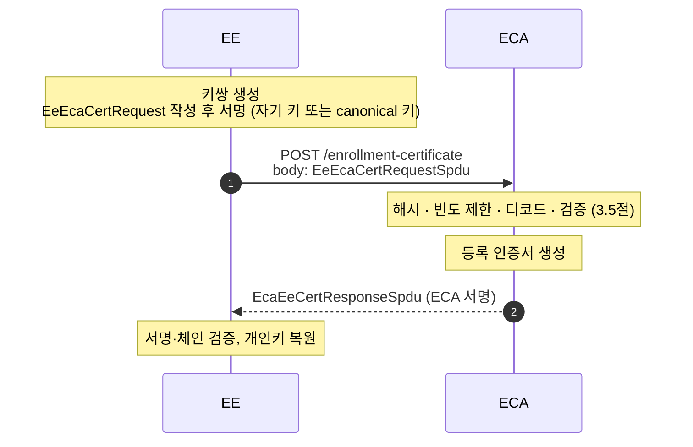

- 등록 인증서 요청은 **암호화하지 않는다.** 기밀성은 TLS 같은 세션 계층에 맡긴다.

> 📖 **규격 참고** : 4.1.4.2 Initial enrollment certificate request/download (p.19), 6.3.4.2 / **Table 9 (p.51~52)**

## 5.2 요청 만들기 (EE)

1. 등록 인증서용 키쌍을 새로 만든다.
2. `EeEcaCertRequest` 를 작성한다. 공개키는 `tbsCert.verifyKeyIndicator.verificationKey` 에 넣는다.
3. 서명한다. 어떤 키로 서명하는지는 등록 자격 방식(2.4절)에 따른다.
   - direct : **canonical 개인키**로 서명, `canonicalId` 포함
   - indirect : 1 에서 만든 **새 개인키로 자기 서명**(signer = self), `canonicalId` 생략


_EeEcaCertRequestSpdu 구조_

| 필드                                         | 의미                                                                                                                                               |
| -------------------------------------------- | -------------------------------------------------------------------------------------------------------------------------------------------------- |
| `version`                                    | 메시지 버전 (2)                                                                                                                                    |
| `generationTime`                             | 요청 생성 시각                                                                                                                                     |
| `type`                                       | 받고 싶은 인증서 형식 : explicit / implicit                                                                                                        |
| `tbsCert.certRequestPermissions`             | 이 등록 인증서로 **나중에 요청할 수 있는 권한의 범위**                                                                                             |
| `tbsCert.verifyKeyIndicator.verificationKey` | explicit : 인증서에 그대로 들어갈 검증 공개키 / implicit : 공개키 재구성의 입력 공개키 `RU`. 요청에서는 **두 형식 모두 `verificationKey`** 를 쓴다 |
| `canonicalId` (OPTIONAL)                     | canonical 공개키를 찾는 식별자. `scmsV3-eeAuth = canonical` 일 때만 넣는다                                                                         |

- 서명 구조는 어느 방식이든 `SignerSelf` 다. **서명에 쓰는 개인키만 다르다** : `canonicalId` 가 있으면 canonical 개인키, 없으면 `verificationKey` 에 대응하는 개인키.

> `tbsCert.cracaId` 와 `crlSeries` 는 요청 시 `'000000'H`, `0` 으로 고정이고, **실제 값은 ECA 가 채운다.** ECA 는 정책에 따라 요청과 다른 내용으로 인증서를 발급할 수 있다.
{: .prompt-tip }

> 📖 **규격 참고** : 7.3.31 EeEcaCertRequest (p.93~94), 7.3.46 SignedCertificateRequest – self 서명 입력 규칙 (p.100~101), 7.3.48 SignerSelf (p.102), **7.4.10 EeEcaCertRequestSpdu (p.106)**, 7.5.5 Ieee1609Dot2Data-SignedCertRequest (p.111)

## 5.3 요청 처리 (ECA)

3.5절의 공통 순서를 따른다. 이 API 에서 달라지는 점은 다음과 같다.

- **빈도 제한** : 400-71 `eca-maxReqs`, 400-73 `eca-minWait`
- **디코드** : 암호화가 없으므로 바로 디코드한다. `canonicalId` 가 있으면 canonical 공개키로, 없으면 요청 안의 `verificationKey` 로 서명을 검증한다.

**검증 항목**

| 에러 코드                                | 검사 내용                                                                                            | 규격 근거                            |
| ---------------------------------------- | ---------------------------------------------------------------------------------------------------- | ------------------------------------ |
| 400-31 disallowed certRequestPermissions | ECA 인증서가 요청된 `certRequestPermissions` 를 발급할 수 있는가                                     | 7.6.3.5 (p.120), 7.6.3.7 (p.120~121) |
| 400-64 invalid verifyKeyIndicator        | 등록된 canonical 공개키 / 요청의 `verifyKeyIndicator` 가 유효한가 (`verificationKey` choice 여야 함) | 7.3.31 (p.94)                        |
| 400-43 failed signature verification     | `tbsRequest` 서명 검증                                                                               | 10.1.2 b) (p.155), 7.3.46 (p.100)    |
| 400-50 future generationTime             | 생성 시간이 미래인가                                                                                 | Table 8 (p.48)                       |
| 400-70 outside eca-maxAge                | 생성 시간이 너무 과거인가                                                                            | Table 5 (p.35)                       |
| 400-33 disallowed region                 | 허용된 지역인가                                                                                      | 10.1.3 (p.156)                       |
| 400-34 disallowed type                   | 허용된 인증서 형식(explicit / implicit)인가                                                          | 7.3.31 NOTE 2 (p.94)                 |
| 400-35 disallowed validityPeriod         | 허용 가능한 유효기간인가                                                                             | Table 9 (p.51)                       |
| 400-72 outside eca-maxWait               | `validityPeriod.start − generationTime` 이 허용 범위인가                                             | Table 5 (p.35)                       |
| 400-32 / 400-66                          | 그 밖의 필드가 정책에 맞는가 / 형식상 올바른가                                                       | Table 9 (p.51)                       |
| 400-36 disallowed certificate identifier | 요청한 `id` 가 허용되는가                                                                            | Table 9 (p.51)                       |
| 400-65 invalid canonical identifier      | `canonicalId` 로 등록된 장치를 찾을 수 있는가                                                        | Table 9 (p.51)                       |
| 400-42 failed parsing                    | 요청을 디코드할 수 있는가                                                                            | Table 9 (p.51)                       |
| 400-80 wrong ECA                         | 이 ECA 로 보낸 요청이 맞는가                                                                         | Table 9 (p.51)                       |

> 📖 **규격 참고** : Table 9 canonicalId 유무 조건 (p.51), 10.1.2 Common validity conditions (p.155~156), **10.1.3 Initial (self-signed) enrollment certificate requests (p.156)** — 자기 서명 요청의 `tbsCert` 는 등록 인증서 프로파일(7.6.3.7)에 맞아야 하고, 그 밖의 형식·지역·권한은 정책으로 제한할 수 있다.

## 5.4 등록 인증서 생성 (ECA)


_등록 인증서 구성 (태그 = 값의 출처)_

- implicit 이면 2.2.2절의 ECQV 로 만든다.
  - **public reconstruction value** `PU = kG + RU` → 인증서 `verifyKeyIndicator`
  - **private reconstruction value** `r` → 응답의 `privateKeyInfo`
- `appPermissions` 의 PSID 35(0x23) = **SecurityMgmtPsid**, SSP `8C0002` = SecurityMgmtSsp 의 `ee : {version 2}` 이다.

> 📖 **규격 참고** : **7.6.3.7 Enrollment certificate profile (p.120~121)**, 7.3.45 SecurityMgmtPsid (p.100), 7.6.2.2 · 7.6.2.7 SecurityMgmtSsp · EeSsp (p.114~116), **Annex E.6 Enrollment certificate 예시 인코딩 (p.208~209)**

## 5.5 응답 만들기 (ECA)

응답은 **3겹 상자**다 : `ScmsPdu` 작성 → OER 인코드 → `unsecuredData` 에 삽입 → ECA 개인키로 `tbsData` 서명 → 전체 인코드.


_EcaEeCertResponseSpdu 구조_

| 필드                        | 의미                                                                                                      |
| --------------------------- | --------------------------------------------------------------------------------------------------------- |
| `version`                   | 메시지 버전 (2)                                                                                           |
| `generationTime`            | 응답 생성 시각                                                                                            |
| `requestHash`               | 원래 `EeEcaCertRequestSpdu` 의 HashedId8                                                                  |
| `ecaCertChain`              | ECA 부터 Root CA 까지의 인증서 체인                                                                       |
| `certificate`               | 발급된 등록 인증서. explicit 이면 검증 공개키, implicit 이면 재구성 값(`reconstructionValue`)이 들어 있다 |
| `privateKeyInfo` (OPTIONAL) | 개인키 복원값 `r` (32바이트). **implicit 이면 반드시 있다**                                               |

> 📖 **규격 참고** : **7.3.32 EcaEeCertResponse (p.94~95)** — requestHash, ecaCertChain(ECA ~ Root), certificate, privateKeyInfo(implicit 이면 필수) / **7.4.9 EcaEeCertResponseSpdu (p.106)** — 서명 인증서는 SecurityMgmtPsid + EcaSsp / 7.5.4 Ieee1609Dot2Data-Signed (p.110~111)

## 5.6 응답 처리 (EE)

응답을 **바깥에서 안쪽으로** 하나씩 검증한다.

| 순서        | 할 일                                                         | 확인 내용                                                                 |
| ----------- | ------------------------------------------------------------- | ------------------------------------------------------------------------- |
| ① 파싱      | `Ieee1609Dot2Data-Signed` 해제                                | `tbsData`, `signer` (= ECA 인증서), `signature`                           |
| ② 서명 검증 | `Hash( Hash(tbsData) ‖ Hash(ECA cert) )` 를 ECA 공개키로 검증 | ECA 인증서가 CCF 체인에 있고 SSP 가 ECA 인가                              |
| ③ 본문 파싱 | `EcaEeCertResponse` 디코드                                    | `generationTime` 이 정상 범위인가, `requestHash` 가 내 요청 해시와 같은가 |
| ④ 체인 검증 | `ecaCertChain` (ECA → ICA → Root)                             | 4.4절과 같은 방법. Root 는 CTL 에 있어야 함                               |
| ⑤ 키 처리   | `certificate` + `privateKeyInfo`                              | 2.2.3절 표대로 공개키·개인키를 얻고 **키쌍이 맞는지** 확인                |

확인이 끝나면 **등록 인증서 + 개인키**를 안전하게 저장한다. 이후 인가 인증서 요청·다운로드와 갱신 요청의 서명에 쓴다.

> 📖 **규격 참고** : **7.3.32 EcaEeCertResponse (p.94~95)**, 7.4.9 EcaEeCertResponseSpdu (p.106), 7.6.3.5 ECA 인증서 프로파일 (p.120), 8.2.4.2 개인키·공개키 대응 확인 (p.124)

---

# 6. 인가 인증서 요청 (EE ↔ RA ↔ ACA)

## 6.1 흐름

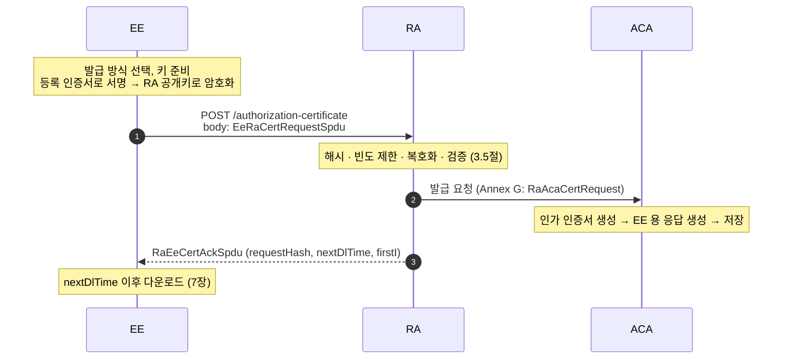

- RA 는 "요청을 승인할지" 판단하는 **창구**이고, ACA 는 RA 가 승인한 요청에 대해 인증서를 찍어 낸다.
- EE 는 요청에 대한 응답으로 인증서를 받지 않는다. **Ack 에 적힌 시각 이후 다운로드**한다.

> 📖 **규격 참고** : 4.1.1 RA 역할 (p.13), **4.1.4.3.2 기본 흐름 a)~f) (p.20~21)**, 6.3.5.2 / **Table 10 (p.54)**, Annex G ACA–RA interface (p.217~221, 참고용)

## 6.2 요청 만들기 (EE)

1. `GET /ra-certificate` 로 **RA 인증서**를 받아 둔다. 요청을 암호화할 `encryptionKey` 가 들어 있다.
2. **발급 방식을 고르고 키를 준비한다** (2.5.2절).
   - plain / private : 서명 키쌍 (+ private 은 응답 암호화 키쌍)
   - butterfly : caterpillar 키쌍과 확장 함수 키
3. `EeRaCertRequest` 를 작성한다. 공개키(또는 caterpillar 공개키)는 `tbsCert.verifyKeyIndicator`, 나머지는 `additionalParams` 에 넣는다.
4. **등록 인증서로 서명**한다 (`SignedCertificateRequest`, signer = 등록 인증서).
5. RA 의 `encryptionKey` 로 **ECIES 암호화**한다 (2.6절). KDF 파라미터에는 RA 인증서의 해시를 쓴다.


_EeRaCertRequestSpdu 구조 : 서명 후 암호화_

| 필드                                         | 의미                                                                                                                                                        |
| -------------------------------------------- | ----------------------------------------------------------------------------------------------------------------------------------------------------------- |
| `version` / `generationTime`                 | 메시지 버전 (2) / 요청 생성 시각                                                                                                                            |
| `type`                                       | explicit / implicit                                                                                                                                         |
| `tbsCert.id`                                 | `linkageData` 면 pseudonym 요청 (ACA 가 실제 linkage value 로 바꿔 넣음). 그 밖의 값이면 identification 요청 (그대로 인증서에 들어감)                       |
| `tbsCert.validityPeriod`                     | 1장 요청이면 그 인증서의 유효기간, butterfly 면 **첫 번째 인증서의 유효기간**                                                                               |
| `tbsCert.region` (OPTIONAL)                  | 적용 지역. 등록 인증서의 region 범위 안이어야 한다                                                                                                          |
| `tbsCert.appPermissions`                     | 요청하는 애플리케이션 권한 (PSID / SSP). 등록 인증서의 `certRequestPermissions` 범위 안이어야 한다                                                          |
| `tbsCert.verifyKeyIndicator.verificationKey` | non-butterfly : 인증서용 공개키 (implicit 이면 재구성 입력 공개키) / butterfly : **caterpillar 서명 공개키 A**                                              |
| `additionalParams` (OPTIONAL)                | 발급 방식을 정하는 CHOICE (2.5.2절). butterfly 면 original / unified / compactUnified 중 하나가 필수, private 이면 `encryptionKey` 가 필수, plain 이면 생략 |

> 📖 **규격 참고** : **7.3.35 EeRaCertRequest (p.96~97)**, 7.3.36 AdditionalParams (p.97~98), **7.4.11 EeRa1609Dot2AuthenticatedCertRequestSpdu (p.107)** — 등록 인증서로 서명하고 RA 인증서의 encryptionKey 로 암호화, 7.4.12 EeRaCertRequestSpdu (p.107), 7.3.49 SignerSingleCert (p.102), 6.3.5.12 RA certificate download (p.73~75), 7.6.3.10 RA 인증서 프로파일 (p.121~122)

## 6.3 요청 처리 (RA)

3.5절의 공통 순서를 따른다. 이 API 에서 달라지는 점은 다음과 같다.

- **빈도 제한** : 400-79 `ra-maxReqs`, 400-711 `ra-minWait`
- **복호화 · 디코드**

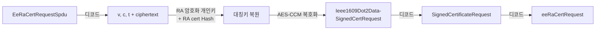

**검증 항목**

| 에러 코드                                               | 검사 내용                                                                                   | 규격 근거                 |
| ------------------------------------------------------- | ------------------------------------------------------------------------------------------- | ------------------------- |
| 400-21 unregistered enrollment certificate              | 서명한 등록 인증서가 이 RA 에 등록돼 있는가                                                 | 4.1.4.3.1 (p.20)          |
| 400-20 blocked enrollment certificate                   | 차단된 등록 인증서인가                                                                      | 4.1.4.3.1 (p.20)          |
| 400-40 failed certificate chain verification            | 등록 인증서의 발급자가 ECA 인가 (체인)                                                      | 10.1.2 c) 3) (p.156)      |
| 400-62 invalid enrollment certificate                   | 등록 인증서에서 공개키를 복원할 수 있는가, 프로파일에 맞는가                                | 10.1.5.1 (p.161), 7.6.3.7 |
| 400-43 failed signature verification                    | `tbsRequest` 서명 검증 (등록 인증서 공개키로)                                               | 10.1.2 b) (p.155)         |
| 400-712 outside enrollment certificate's validityPeriod | 요청 `generationTime` 이 **서명한 등록 인증서의 유효기간** 안인가                           | 10.1.5.1 (p.160)          |
| 400-50 future generationTime                            | 생성 시간이 미래인가                                                                        | Table 8                   |
| 400-77 outside ra-maxAge                                | 생성 시간이 너무 과거인가                                                                   | Table 6 (p.36)            |
| 400-33 disallowed region                                | 요청 region 이 등록 인증서 region 안인가                                                    | 10.1.5.1 (p.161)          |
| 400-34 disallowed type                                  | 허용된 인증서 형식인가 (정책)                                                               | 10.1.5.1 (p.161)          |
| 400-35 disallowed validityPeriod                        | 요청 유효기간이 허용 범위인가 (non-butterfly 는 등록 인증서 만료 전)                        | 10.1.6 (p.161)            |
| 400-78 outside ra-maxGenDelay                           | `validityPeriod.start − generationTime` 이 허용 범위인가                                    | 10.1.5.2, 10.1.6 (p.161)  |
| 400-30 / 400-60 appPermissions                          | 요청 `appPermissions` 가 등록 인증서 `certRequestPermissions` 범위 안인가 / 형식상 올바른가 | **10.1.7 (p.162~164)**    |
| 400-10 absent encryption                                | 요청이 암호화돼 있는가                                                                      | Table 10 (p.54)           |
| 400-41 / 400-42                                         | 복호화 / 디코드에 성공했는가                                                                | Table 10 (p.54)           |
| 400-63 invalid region                                   | region 값 자체가 올바른가                                                                   | Table 10 (p.54)           |
| 400-32 / 400-36 / 400-66                                | 그 밖의 필드 · 인증서 식별자가 정책에 맞는가 / 형식상 올바른가                              | Table 10 (p.54)           |
| 400-81 wrong RA                                         | 이 RA 로 보낸 요청이 맞는가                                                                 | Table 10 (p.54)           |

> 📖 **규격 참고** : Table 10 에러 목록 (p.54), Table 6 (p.36), **10.1.5 Authorization certificate requests signed by 1609.2 enrollment certificates (p.160~161)**, 10.1.6 without butterfly keys (p.161), 10.1.7 appPermissions ↔ certRequestPermissions (p.162~164)

## 6.4 인가 인증서 생성 (ACA)

### 6.4.1 발급 개수

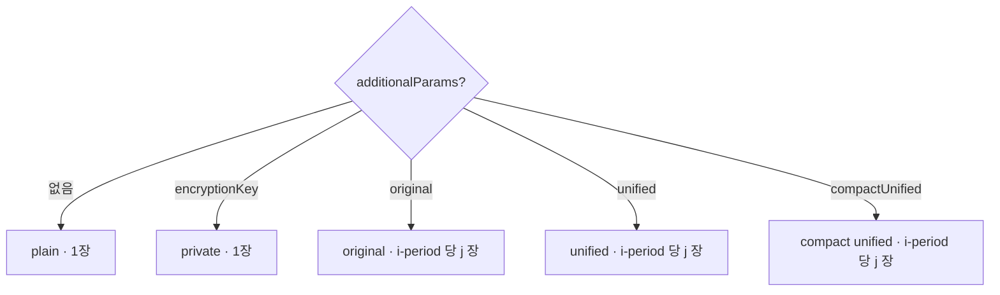

- butterfly 에서 i-period 당 인증서 수(j 개수)는 정책값이다. 규격의 `time-baseCertNumber` 에 해당하며, 규격 예시(미국 CV Pilot)는 주당 20장이다.

> 📖 **규격 참고** : 9.3.6.2~9.3.6.5 (p.138~140), 4.3.2 Time period parameters / Table 1 (p.29), 4.3.2.4.2 Overlap approach 예시 — baseCertNumber 20 (p.31)

### 6.4.2 plain / private : 인증서 1장


_인가 인증서 구성_


_plain / private 인가 인증서 공개키 생성 · 복원_

### 6.4.3 butterfly : 인증서 여러 장

plain 과 다른 점은 다음과 같다.

| 항목             | plain / private       | butterfly                                                                |
| ---------------- | --------------------- | ------------------------------------------------------------------------ |
| `id`             | none                  | **linkageData** (iCert = i, linkage-value)                               |
| `validityPeriod` | 요청 값 복사          | **i-period 로 계산** (`iPeriodEpoch`, `iPeriodInit`, `iPeriodLength`, i) |
| ECQV 입력 공개키 | EE 공개키 `RU` 그대로 | **cocoon 공개키 `B(i,j)`** (2.5.1절)                                     |
| 개수             | 1                     | j 개 반복                                                                |

- 세 butterfly 방식 모두 caterpillar 공개키는 `tbsCert.verifyKeyIndicator` 이고, 확장 함수 키만 `additionalParams` 의 위치가 다르다.
- 이후는 implicit 인증서 생성과 같다 : `PU = kG + B(i,j)` → 인증서, `r` → `privateKeyInfo`.


_butterfly 인가 인증서 공개키 생성 · 복원_

> 📖 **규격 참고** : **9.3.3.1 Butterfly expansion functions (p.135)**, 9.3.4 Cocoon key derivation (p.136~137), 9.3.5.1 b) implicit 인 경우 butterfly 개인키 (p.137), 4.3.2.2 i-period → validity 계산식 (p.30), Annex F linkage value (p.213~)

## 6.5 EE 용 응답 만들기 (ACA)

모든 경우의 공통 알맹이는 `AcaEeCertResponse` 이다.


_AcaEeCertResponse_

이 알맹이를 **어떻게 포장하느냐**가 발급 방식마다 다르다. 어떤 키로 암호화하고 서명하는지는 2.5.3절 표와 같다.


_발급 방식별 응답 포장_

1. 암호화가 필요한 방식이면, 2.5.3절의 "응답 암호화 공개키"로 `AcaEeCertResponse` 를 ECIES 암호화한다(2.6절). 수신자 정보는 `rekRecipInfo{ v, c, t }` 다.
2. private · original · unified 는 결과를 `unsecuredData` 에 넣고 **ACA 인증서로 서명**한다.
3. 만든 응답은 다운로드 때까지 저장해 둔다. 파일 이름은 `requestHash`(와 i, j)로 정한다 (7장).

> private 응답은 **"서명한 ACA 인증서 = 안의 인증서를 발급한 ACA 인증서"** 일 때만 유효하다. EE 는 서명자와 안쪽 `certificate.issuer` 가 일치하는지 확인해야 한다.
{: .prompt-info }

> 📖 **규격 참고** : **7.3.4 AcaEeCertResponse (p.84~85)**, **7.4.2 AcaEeCertResponseCubkSpdu (p.103)**, **7.4.3 AcaEeCertResponsePlainSpdu (p.103)**, **7.4.4 AcaEeCertResponsePrivateSpdu — 암호화 키 결정 규칙, 서명자 일치 (p.103~105)**, 7.5.3 EncryptedSigned (p.110), 9.2.4 ACA 가 서명하는 이유 (p.132), 9.3.6.3~9.3.6.5 응답 유효성 / cubk 플래그 (p.139~140)

## 6.6 Ack (RA → EE)


_RaEeCertAckSpdu 구조_

EE 는 `signer` 인 **RA 인증서**로 서명을 검증한 뒤(RA 인증서는 CCF 로 확인) 필드를 처리한다.

| 필드             | 의미                                         | EE 가 할 일                                                      |
| ---------------- | -------------------------------------------- | ---------------------------------------------------------------- |
| `generationTime` | Ack 생성 시각                                | 미래이거나 너무 오래되지 않았는지 확인                           |
| `requestHash`    | 내가 보낸 `EeRaCertRequestSpdu` 의 HashedId8 | **내 요청 해시와 같은지 확인**. 다운로드 파일 이름의 `h` 로 저장 |
| `firstI`         | butterfly 일 때 첫 i 값                      | 파일 이름 `h_i.zip` 의 `i` 로 저장                               |
| `nextDlTime`     | 다운로드 가능 시각                           | 이 시각 이후 다운로드 요청 (7장)                                 |

> 📖 **규격 참고** : **7.3.39 RaEeCertAck (p.98~99)**, **7.4.18 RaEeCertAckSpdu (p.108~109)**, Table 10 HTTP response body (p.54), 7.6.3.10 RA 인증서 프로파일 (p.121~122), 8.2.2 Naming convention (p.122~123), 4.3.2.3 iPeriod (p.30)

---

# 7. 인가 인증서 다운로드 (EE ↔ RA ↔ ACA)

## 7.1 흐름

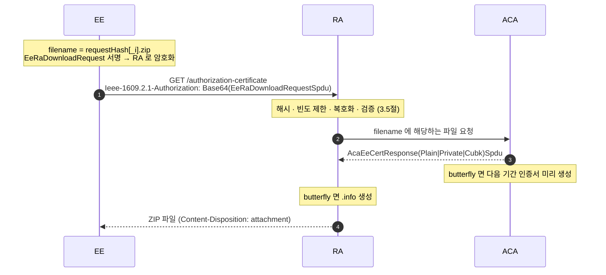

> 📖 **규격 참고** : 4.1.4.3.3 Authorization certificate download (p.21), 6.3.5.3.2 / **Table 11 (p.55~57)**, filename 을 URL 에 넣는 변형은 6.3.5.3.3 / Table 12 (p.58~59)

## 7.2 요청 만들기 (EE)

인가 인증서 요청과 같은 **"서명 후 암호화"** 패턴이다. 단 안쪽 서명 형식이 `SignedCertificateRequest` 가 아니라 일반 `Ieee1609Dot2Data-Signed` 이다.

1. `EeRaDownloadRequest { generationTime, filename }` 를 작성한다.
   - `filename` : `{requestHash}.zip` 또는 butterfly 면 `{requestHash}_{i}.zip`
   - `requestHash` 는 16자리 hex, `i` 는 **최소 길이 hex** (76 → `4C`)
2. 등록 인증서로 서명하고 RA 공개키로 암호화한다.
3. GET 이라 본문이 비어 있으므로 SPDU 를 **헤더**에 Base64 로 싣는다.


_EeRaDownloadRequestSpdu 구조_

```http
GET /v3/authorization-certificate HTTP/1.1
Ieee-1609.2.1-Authorization: <Base64(EeRaDownloadRequestSpdu)>
```

> 📖 **규격 참고** : **7.3.41 EeRaDownloadRequest (p.99~100)**, **7.4.14 EeRaDownloadRequestSpdu (p.107)**, 7.4.13 EeRaDownloadRequestPlainSpdu (eeAuth=none, p.107), **8.2.2 Naming convention (p.122~123)**, 6.1.3 / 3.1 minimal length hex (p.43), 6.3.1.4 Ieee-1609.2.1-Authorization (p.47)

## 7.3 요청 처리 (RA)

3.5절의 공통 순서를 따른다. 이 API 에서 달라지는 점은 다음과 같다.

- **해시 · 빈도 제한** : 헤더에서 Base64 를 풀어 해시(`downloadHash`)를 만든다. 400-75 `download-maxReqs`, 400-76 `download-minWait`
- **복호화 · 디코드** : 6.3 과 같다. 안쪽이 `Ieee1609Dot2Data-Signed` → `EeRaDownloadRequest` 라는 점만 다르다.

**검증 항목**

| 에러 코드                                               | 검사 내용                                                |
| ------------------------------------------------------- | -------------------------------------------------------- |
| 400-21 / 400-20                                         | 등록된 등록 인증서인가, 차단되지 않았는가                |
| 400-40 failed certificate chain verification            | 등록 인증서 체인(ECA 발급) 검증                          |
| 400-43 failed signature verification                    | `tbsData` 서명 검증                                      |
| 400-712 outside enrollment certificate's validityPeriod | 등록 인증서 유효기간 안인가                              |
| 400-50 / 400-74                                         | 생성 시간이 미래이거나 너무 과거인가                     |
| 400-10 / 400-41 / 400-42                                | 암호화 누락 / 복호화 실패 / 디코드 실패                  |
| 400-62 invalid enrollment certificate                   | 서명한 등록 인증서가 올바른가                            |
| 400-75 / 400-76                                         | `download-maxReqs` 초과 / `download-minWait` 안에 재요청 |
| 400-81 wrong RA                                         | 이 RA 로 보낸 요청이 맞는가                              |
| (404 not found)                                         | `requestHash` / i 가 틀렸거나 아직 파일이 만들어지기 전  |
| (416)                                                   | HTTP Range 를 처리할 수 없음 → Range 없이 재시도         |

- 다운로드 요청은 **원래 요청에 쓴 등록 인증서 또는 그 successor** 로 서명해야 한다. RA 는 filename 의 `requestHash` 가 이 EE 의 요청인지도 확인한다.

> 📖 **규격 참고** : Table 7 Download 파라미터 (p.37), **Table 11 Errors (p.57)**, 4.1.4.3.3 a) 1) (p.21), 4.1.4.3.1 blocked/unregistered (p.20)

## 7.4 응답 만들기 (RA · ACA)

- **ACA** : filename 에 해당하는 저장 파일(`AcaEeCertResponse…Spdu`)을 RA 에 넘긴다. butterfly 라면 **다음 기간(i+1) 인증서를 미리 생성**해 둔다 (top-off 방식).
- **RA** : butterfly 라면 `.info` 파일(`RaEeCertInfoSpdu`)을 만든다. 받은 파일과 함께 **무압축 ZIP** 으로 묶어 응답한다.
- 응답은 SPDU 하나가 아니라 **ZIP 파일 자체가 HTTP 본문**이다. 파일 이름은 헤더로 알려 준다.

```http
HTTP/1.1 200 OK
Content-Disposition: attachment; filename="AB09281C9867DE53_9AB.zip"
```

| 구분          | ZIP 이름                      | ZIP 안                                            |
| ------------- | ----------------------------- | ------------------------------------------------- |
| non-butterfly | `h.zip`                       | 응답 파일 `h` **1개**                             |
| butterfly     | `h_i.zip` (i-period 마다 1개) | `i.info` 1개 + 인증서별 응답 `i_0` … `i_(jmax−1)` |

`h` = `requestHash`(16자리 hex), `i` = i-period 값(최소 길이 hex), `j` = 기간 안의 번호(0 ~ jmax−1, hex) 다.


_RaEeCertInfoSpdu 구조 (.info 파일)_


_다운로드 ZIP 구조_

- ACPC 를 쓰면 `acpcTreeId` 가 들어가고 RA 서명이 붙은 `RaEeCertAndAcpcInfoSpdu` 를 쓴다.

> 📖 **규격 참고** : **7.3.40 RaEeCertInfo (p.99)**, **7.4.20 RaEeCertInfoSpdu (p.109)**, 7.4.19 RaEeCertAndAcpcInfoSpdu (p.109), **8.2.1 무압축 ZIP, i/j (p.122)**, **8.2.3 File contents (p.123~124)**, 8.2.4 Validity of certificates in zip files (p.124), Introduction 의 top-off (p.viii), 9.4 ACPC (p.141~)

## 7.5 응답 처리 (EE)

### 7.5.1 ZIP 풀기와 처리 순서

- **non-butterfly** : ZIP 안에 파일이 하나(`h`)만 있다.
- **butterfly** : `{i}.info` 1개와 인증서 파일 `{i}_{j}` 들이 있다 (예 : `1FE.info`, `1FE_0`, `1FE_1` …). 유효기간 시작이 다른 인증서는 `overlap` 하위 폴더에 있을 수 있다.
- 인증서 파일 하나는 **`AcaEeCertResponsePlainSpdu` / `PrivateSpdu` / `CubkSpdu` 중 하나**를 C-OER 로 인코딩한 것이다.

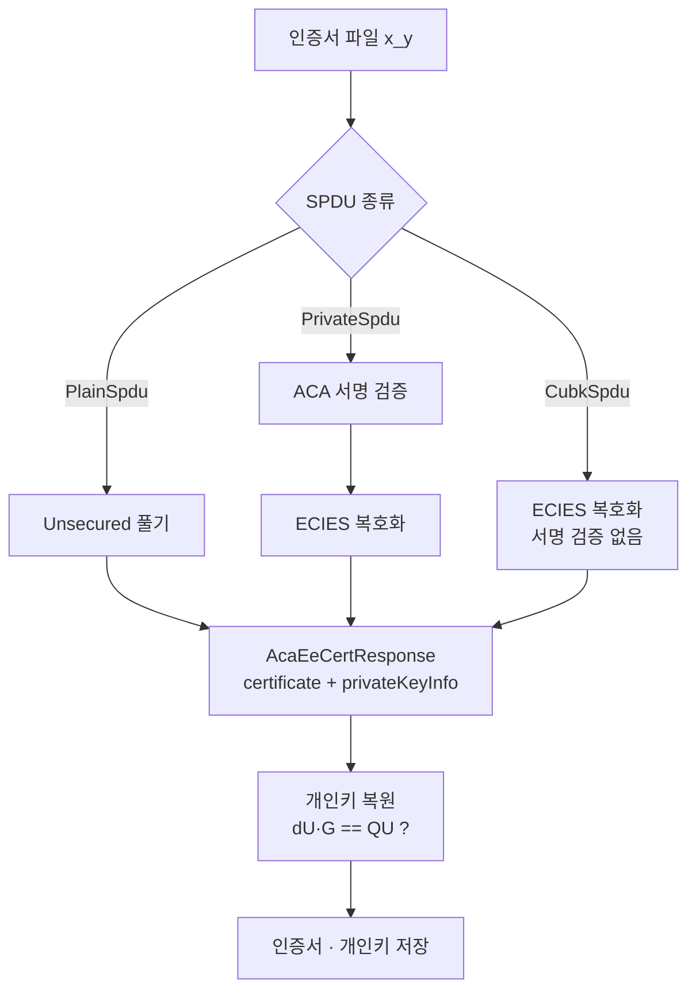

> 📖 **규격 참고** : **8.2.3.1 / 8.2.3.2 File contents (p.123~124)**, 7.4.2~7.4.4 (p.103~105)

### 7.5.2 ACA 서명 검증 (PrivateSpdu)

1. 바깥 `signer` 인 **ACA 인증서**를 CCF 체인으로 확인한다 (4.4절).
2. `Hash( Hash(tbsData) ‖ Hash(ACA cert) )` 를 ACA 공개키로 검증한다.
3. 복호화한 뒤 안쪽 `certificate.issuer` 가 **서명한 ACA 인증서**와 같은지 확인한다.
4. `cubk` 플래그 검사 : PrivateSpdu(original · unified)는 ACA 인증서에 `cubk` 비트가 **없어야**, CubkSpdu 는 **있어야** 유효하다.

> 📖 **규격 참고** : **7.4.4 AcaEeCertResponsePrivateSpdu (p.103~105)**, 7.4.2 AcaEeCertResponseCubkSpdu (p.103), **9.3.6.3.2 / 9.3.6.4.2 / 9.3.6.5.2 응답 유효성 · cubk (p.139~140)**, 7.6.3.2 ACA 인증서 프로파일 (p.119)

### 7.5.3 복호화와 개인키 복원

butterfly(original, implicit)를 예로 들면 EE 는 파일 `i_j` 하나마다 아래 순서를 밟는다. plain·private 은 ①의 cocoon 계산 없이 요청 때 만든 개인키를 그대로 쓴다.

| 단계            | 계산                                                                  | 입력                                                                 | 결과                                      |
| --------------- | --------------------------------------------------------------------- | -------------------------------------------------------------------- | ----------------------------------------- |
| ① cocoon 개인키 | `b(i,j) = (a + fS(kS, i, j)) mod n`                                   | 보관해 둔 caterpillar 개인키 `a`, 확장 키 `kS`, 파일 이름의 i, j     | 서명용 cocoon 개인키                      |
| ② 응답 복호화   | `q(i,j) = (p + fE(kE, i, j)) mod n` 으로 ECIES 복호화 (2.6절)         | 암호화용 `p`, `kE` (unified 계열은 `b(i,j)` 를 그대로 사용, 2.5.3절) | `certificate` + `privateKeyInfo = r(i,j)` |
| ③ 해시          | `e = Hash( Hash(인가 인증서 tbs) ‖ Hash(ACA 인증서) )` 를 정수로 변환 | 받은 인증서, ACA 인증서                                              | `e(i,j)`                                  |
| ④ 최종 개인키   | `dU = (r + e·b(i,j)) mod n`                                           | ①, ②, ③                                                              | **V2X 서명에 쓸 butterfly 개인키**        |
| ⑤ 공개키 복원   | `QU = e·PU + QACA`                                                    | 인증서의 재구성 값 `PU`, ACA 공개키                                  | 인증서의 검증 공개키                      |
| ⑥ 키쌍 확인     | **`dU·G == QU` ?**                                                    | ④, ⑤                                                                 | 다르면 쓰지 않는다                        |

- `n` 은 타원곡선 기준점 G 의 차수(규격의 ℓ)다.
- ① 의 `b(i,j)` 는 **아직 최종 개인키가 아니다.** ACA 의 기여값 `r` 을 더한 ④ 가 최종 개인키다.
- ⑤ 의 `PU`(인증서 `verifyKeyIndicator.reconstructionValue`)는 2.5.1절의 암호화용 caterpillar 공개키 `P` 와 **다른 값**이다.
- `i` 는 `.info` 와 파일 이름에서, `j` 는 파일 이름 `{i}_{j}` 에서 얻는다. ACA 가 cocoon 공개키를 계산할 때 쓴 i, j 와 같아야 한다.
- ⑥ 은 키쌍만 확인한다. 유효기간 · 발급자 신뢰 같은 인증서 검증은 따로 한다(8.2.4).

> 📖 **규격 참고** : **9.3.4.1 Cocoon private key derivation (p.136)**, **9.3.5.1 butterfly 개인키 (p.137)**, **8.2.4.2 Correspondence between private key and public key (p.124)**, 7.3.4 AcaEeCertResponse.privateKeyInfo (p.85)

### 7.5.4 .info 파일 처리

| 필드             | EE 가 할 일                                                   |
| ---------------- | ------------------------------------------------------------- |
| `generationTime` | 정상 범위인지 확인                                            |
| `requestHash`    | 원래 `EeRaCertRequestSpdu` 의 해시와 같은지 확인              |
| `currentI`       | 이번 배치의 i. 파일 이름과 cocoon 키 계산에 쓴다              |
| `nextDlTime`     | 다음 배치를 받을 시각. 이 시각 이후 다음 i 의 파일을 요청한다 |

> 📖 **규격 참고** : **7.3.40 RaEeCertInfo (p.99)**, 7.4.20 RaEeCertInfoSpdu (p.109), 8.2.3.2 a) .info 파일 (p.123)

---

# 8. 등록 인증서 갱신 (Successor, EE ↔ RA ↔ ECA)

## 8.1 개요

등록 인증서가 만료되기 전에, **현재 등록 인증서로 서명해서 새 등록 인증서를 받는** 기능이다.

- successor 는 부모 인증서의 **소유권이 이어진다**는 뜻이다. 부모로 받을 수 있던 인가 인증서를 successor 로도 계속 받을 수 있다.
- 인증서 안에 successor 표시는 없다. 부모–자식 관계는 SCMS(RA 등)가 관리한다.
- 최초 등록(5장)과 달리 **ECA 가 아니라 RA** 에 요청하고, 인가 인증서처럼 **요청 → Ack → 다운로드** 로 받는다. RA–ECA 사이의 절차는 범위 밖이다.
- 갱신하려면 현재 등록 인증서에 `canRequestRollover` 가 있어야 하고, 차단된 EE 는 갱신할 수 없다.

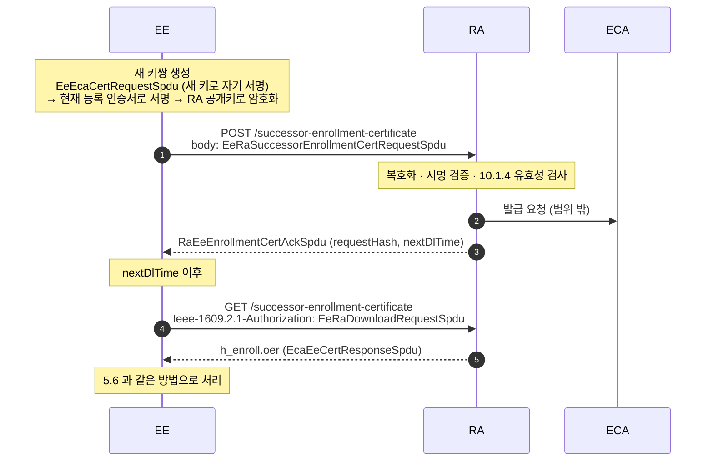

> 📖 **규격 참고** : **4.1.4.3.4 Successor enrollment certificate request (p.22)**, **4.1.4.3.5 download (p.22)**, 4.1.4.3.1 차단된 EE 는 갱신 불가 (p.20), 7.6.3.7 canRequestRollover (p.121)

## 8.2 요청 만들기 (EE)


_Successor Enrollment 의 SPDU 포장_

1. 새 키쌍을 만든다.
2. `EeEcaCertRequest` 를 작성한다. **`canonicalId` 는 넣지 않는다.**
3. 새 개인키로 자기 서명해 `EeEcaCertRequestSpdu` 를 만든다 (5.2 와 같은 구조).
4. 3 을 `eeRaSuccessorEnrollmentCertRequest` 에 넣고 **현재 등록 인증서로 서명**한다. 형식은 인가 인증서 요청과 같은 `SignedCertificateRequest` 다.
5. RA 의 `encryptionKey` 로 ECIES 암호화한다 → `EeRaSuccessorEnrollmentCertRequestSpdu` (`Ieee1609Dot2Data-SignedEncryptedCertRequest`)

**RA 가 보는 유효성 조건** — 바깥 서명에 쓴 등록 인증서를 기준으로 본다.

| 조건                                                                 | 관련 에러      |
| -------------------------------------------------------------------- | -------------- |
| 안쪽 `generationTime` 이 서명한 등록 인증서의 유효기간 안            | 400-712        |
| 요청 `certRequestPermissions` 가 기존 인증서의 범위와 일관됨         | 400-31, 400-61 |
| 요청 `region` 이 기존 인증서 region 안                               | 400-33, 400-63 |
| 요청 `tbsCert` 와 서명 인증서가 등록 인증서 프로파일(7.6.3.7)을 따름 | 400-62, 400-66 |

> 📖 **규격 참고** : **7.4.15 EeRaSuccessorEnrollmentCertRequestSpdu (p.108)**, 7.3.34 EeRaInterfacePdu (p.95), **6.3.5.4 / Table 13 — canonicalId 금지, 에러 목록 (p.60~61)**, **10.1.4 Successor enrollment certificate requests (p.156~)**

## 8.3 Ack 처리 (EE)

- `RaEeEnrollmentCertAckSpdu` 는 RA 가 서명한 `RaEeCertAck` 다. RA 인증서로 서명을 검증한다.
- 필드는 `generationTime`, `requestHash`, `nextDlTime` 뿐이다. 인가 인증서 Ack 와 달리 **`firstI` 가 없다.**
- `requestHash` 는 내가 보낸 **`EeRaSuccessorEnrollmentCertRequestSpdu` 전체**의 HashedId8 이다. 다운로드 파일 이름에 쓴다.

> 📖 **규격 참고** : **7.4.21 RaEeEnrollmentCertAckSpdu (p.109)**, 7.3.39 RaEeCertAck (p.98~99), Table 13 HTTP response body (p.61)

## 8.4 다운로드 (EE)

1. `EeRaDownloadRequest { generationTime, filename = "{h}_enroll.oer" }` 를 만든다. `h` 는 Ack 의 `requestHash` 를 16자리 hex 로 쓴 값이다.
2. 인가 인증서 다운로드(7.2)처럼 서명·암호화한다.
   - `scmsV3-eeAuth = enrollment` : 현재 등록 인증서(또는 그 successor)로 서명 → RA 로 암호화한 `EeRaDownloadRequestSpdu`
   - `scmsV3-eeAuth = none` : 서명·암호화 없는 `EeRaDownloadRequestPlainSpdu`
3. `GET /successor-enrollment-certificate` 의 `Ieee-1609.2.1-Authorization` 헤더에 실어 보낸다.
4. 응답 파일 `h_enroll.oer` 의 내용은 **`EcaEeCertResponseSpdu`** 다. 처리는 **최초 등록 응답 처리(5.6)와 같다.** 단, 안의 `requestHash` 는 `EeRaSuccessorEnrollmentCertRequestSpdu` 의 해시다.
5. 새 등록 인증서가 확인되면 이후 요청에는 새 인증서를 쓴다.

> 📖 **규격 참고** : **6.3.5.5 / Table 14 (p.62~63)**, **8.3 Successor enrollment certificate download files — h_enroll.oer (p.124~125)**, 7.3.41 EeRaDownloadRequest (p.99~100), 4.1.4.3.5 a) (p.22)

---

# 9. 인증서 폐기와 CRL 검증

## 9.1 폐기 절차 : 오동작 신고에서 CRL 까지

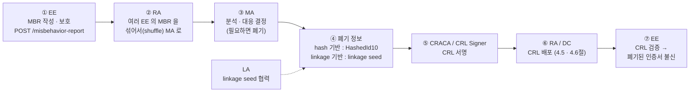

| 단계        | 누가               | 하는 일                                                                                                            | 1609.2.1 이 정하는 범위                                                                           |
| ----------- | ------------------ | ------------------------------------------------------------------------------------------------------------------ | ------------------------------------------------------------------------------------------------- |
| ① 신고      | EE                 | 오동작을 발견하면 **오동작 신고(MBR)** 를 만들어 RA 로 올린다                                                      | 업로드 API 만 (`POST /misbehavior-report`). MBR 형식은 애플리케이션 표준(예 : SAE J3287)이 정한다 |
| ② 전달      | RA                 | 여러 EE 의 신고를 **섞어서(shuffle)** MA 로 보낸다. MA 가 "어느 신고들이 같은 EE 에서 왔는지" 모르게 하기 위해서다 | 개념만                                                                                            |
| ③ 판단      | MA                 | 신고를 분석해 오동작 여부와 원인을 판단하고, 필요하면 폐기를 결정한다. **모든 신고가 폐기로 이어지지는 않는다**    | 범위 밖 (정책·구현)                                                                               |
| ④ 폐기 정보 | MA (+ LA)          | identification 등은 인증서 해시, pseudonym 은 LA 와 협력해 얻은 **linkage seed** 로 폐기 정보를 만든다             | 범위 밖                                                                                           |
| ⑤ 서명      | CRACA / CRL Signer | CRL 에 서명한다. CRACA 가 직접 서명하거나, CRACA 가 직접 발급한 CRL Signer 인증서로 서명한다                       | CRL 형식은 IEEE 1609.2                                                                            |
| ⑥ 배포      | RA / DC            | Composite CRL 또는 개별 CRL 로 배포한다                                                                            | 4.5 · 4.6절                                                                                       |
| ⑦ 확인      | EE                 | CRL 을 검증하고, 받은 메시지의 인증서가 폐기됐는지 확인한다                                                        | 9.2절 (검증 규칙은 IEEE 1609.2)                                                                   |

**MBR 업로드의 프라이버시 장치**

- 업로드는 등록 인증서가 아니라 **오동작 신고용 인가 인증서**(PSID `0x26`)로 인증한다.
- RA 는 이 인증서를 MA 에 넘기지 않는다. MA 가 한 EE 의 인증서들을 엮지 못하게 하기 위해서다.
- 신고의 평문 메타데이터에는 **어느 MA 로 보낼지**만 들어 있고, 신고 내용은 들어 있지 않다.
- 신고하는 EE 는 신고 대상 PSID 를 담당하는 **MA 의 인증서**를 미리 받아 둔다 (`GET /ma-certificate?psid=…`).

> 📖 **규격 참고** : **4.1.4.4 Misbehavior report submission (p.23)**, **4.1.5 Misbehavior authorities — shuffle, PSID 0x26, 가정 (p.23~24)**, 6.3.5.6 Misbehavior report submission (p.64), 6.3.5.13 MA certificate download (p.75~), 4.1.1 CRL Signer · CRACA · LA (p.12)

## 9.2 CRL 로 폐기 여부 확인 (EE)

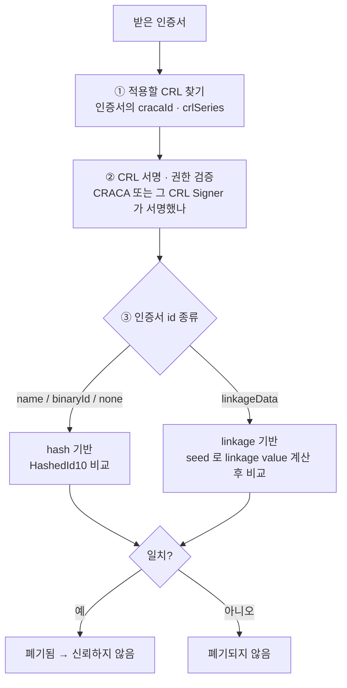

**① 적용할 CRL 찾기**

- 인증서마다 **자기가 실릴 CRL 이 하나로 정해져 있다.** 인증서의 `cracaId`(HashedId3)와 `crlSeries` 가 그 표시다.
- `cracaId` 로 인증서 체인 안의 **CRACA 인증서**를 찾고, 그 인증서의 HashedId8 이 CRL 의 `crlCraca` 와 같은지 본다.
- CRL 의 `crlSeries` 와 폐기 정보 종류(hash / linkage)가 인증서와 맞는지도 확인한다.

**② CRL 서명과 권한 검증**

- CRL 서명을 검증한다. 서명자는 **CRACA 자신**이거나 **CRACA 가 직접 발급한 CRL Signer** 여야 한다.
- 서명자 인증서 체인을 CCF 로 확인한다(4.4절).

**③ 폐기 정보 비교**

full CRL 은 그 자체로, delta CRL 은 **이전 CRL 의 폐기 정보와 합쳐서** 반영한다.

|                | hash 기반                                      | linkage 기반                                                          |
| -------------- | ---------------------------------------------- | --------------------------------------------------------------------- |
| 대상           | 인증서 `id` 가 `name` / `binaryId` / `none`    | 인증서 `id` 가 `linkageData` (pseudonym)                              |
| CRL 에 실린 것 | 폐기된 인증서의 **HashedId10** 목록            | 폐기된 EE 의 **linkage seed** (와 `iRev`, `iMax`, `jMax`, LA 식별자)  |
| 확인 방법      | 받은 인증서의 HashedId10 을 계산해 목록과 비교 | seed 로 그 인증서 기간의 linkage value 들을 계산해 인증서의 값과 비교 |
| 장점           | 단순                                           | 항목 하나로 **그 EE 의 현재·미래 인증서 전부**를 폐기                 |

- **HashedId10** : 인증서 전체를 C-OER 로 인코딩해 해시한 값의 **하위 10바이트**.

**linkage 기반 확인 순서**

1. CRL 항목에서 `iRev`(폐기 기준 기간), `iMax`, `jMax`, seed 를 읽는다.
2. 인증서의 `linkageData.iCert` 를 확인한다. `iCert` 가 `iMax` 보다 크면 그 항목은 적용하지 않는다.
3. seed 를 `iRev` 에서 `iCert` 까지 **한 기간씩 진화**시킨다 (`seed(i+1) = f(seed(i))`).
4. `j = 0 ~ jMax−1` 마다 **pre-linkage value** 를 계산한다.
5. seed 가 둘(LA₁, LA₂)이면 같은 j 의 값을 XOR 해 최종 linkage value 를 만든다.
6. 인증서의 `linkage-value` 와 같은 것이 있으면 **폐기됨**이다.

```
LA₁ seed ─(기간 진화)─> seed₁(iCert) ─(j)─> PLV₁(iCert, j) ─┐
                                                           ⊕ ─> LV(iCert, j)  == 인증서의 linkage-value ?
LA₂ seed ─(기간 진화)─> seed₂(iCert) ─(j)─> PLV₂(iCert, j) ─┘
```

> LA 를 둘로 나누는 이유 : 각 LA 는 자기 PLV 만 알고 최종 LV 를 모른다. RA 는 ACA 용으로 암호화된 PLV 만 보고, ACA 는 RA 의 shuffle 때문에 어느 인증서들이 같은 EE 의 것인지 모른다. 그래서 **어느 한 구성요소도 혼자서는 한 EE 의 인증서들을 묶지 못한다.** 폐기가 필요할 때만 LA·RA·ACA 가 협력해 seed 를 찾아낸다.
{: .prompt-info }

> 📖 **규격 참고** : 4.1.6.1 인증서마다 CRL 이 정해져 있음 (p.24), 4.1.1 CRL Signer ↔ CRACA (p.12), **Annex F.1 linkage value 개념 (p.213)**, **F.2 생성 과정 (p.213~214)**, F.3 성질 (p.215), 7.2.17 HashedId3 · 7.2.19 HashedId10. CRL 구조, 폐기 확인, seed 진화 · PLV 함수는 **IEEE 1609.2** (5.1.3.4 등)에 정의되어 있다.

---

# 10. 한눈에 정리

## 10.1 API 비교

|           | 등록 인증서 발급                 | 인가 인증서 요청                  | 인가 인증서 다운로드             | 갱신 요청                                | 갱신 다운로드                           |
| --------- | -------------------------------- | --------------------------------- | -------------------------------- | ---------------------------------------- | --------------------------------------- |
| 서버      | ECA                              | RA (→ ACA)                        | RA (→ ACA)                       | RA (→ ECA)                               | RA (→ ECA)                              |
| HTTP      | `POST /enrollment-certificate`   | `POST /authorization-certificate` | `GET /authorization-certificate` | `POST /successor-enrollment-certificate` | `GET /successor-enrollment-certificate` |
| 요청 SPDU | EeEcaCertRequestSpdu             | EeRaCertRequestSpdu               | EeRaDownloadRequestSpdu (헤더)   | EeRaSuccessorEnrollmentCertRequestSpdu   | EeRaDownloadRequestSpdu (헤더)          |
| 서명 키   | 새 키(self) / canonical          | 등록 인증서                       | 등록 인증서                      | 새 키(self) + 현재 등록 인증서           | 현재 등록 인증서 (또는 successor)       |
| 암호화    | X (세션 보안)                    | RA 로 ECIES                       | RA 로 ECIES                      | RA 로 ECIES                              | RA 로 ECIES                             |
| 응답      | EcaEeCertResponseSpdu (ECA 서명) | RaEeCertAckSpdu (RA 서명)         | ZIP (AcaEe…Spdu + .info)         | RaEeEnrollmentCertAckSpdu (RA 서명)      | `h_enroll.oer` (EcaEeCertResponseSpdu)  |
| EE 처리   | 5.6                              | 6.6                               | 7.5                              | 8.3                                      | 8.4 → 5.6                               |
| 규격 표   | Table 9                          | Table 10                          | Table 11                         | Table 13                                 | Table 14                                |

**Bootstrap 다운로드 (4장)**

|         | CCF                                               | Composite CRL                                    | 정보 상태                                  |
| ------- | ------------------------------------------------- | ------------------------------------------------ | ------------------------------------------ |
| HTTP    | `GET /ccf-ctl?ctlSeriesId=…`                      | `GET /composite-crl-ctl?ctlSeriesId=…`           | `GET /certificate-management-info-status`  |
| 응답    | `cert-chain_{version}.oer` (CertificateChainSpdu) | `composite-crl_{version}.oer` (CompositeCrlSpdu) | CertificateManagementInformationStatusSpdu |
| 보안    | Unsecured (안의 CTL · 인증서 서명으로 검증)       | Unsecured (안의 CTL · CRL 서명으로 검증)         | -                                          |
| 규격 표 | Table 15                                          | Table 16                                         | Table 22                                   |

## 10.2 규격 위치 모음

| 주제                                                           | IEEE P1609.2.1/D3 위치             |
| -------------------------------------------------------------- | ---------------------------------- |
| 범위 · 목적                                                    | 1.1, 1.2 (p.1)                     |
| SCMS 구성요소 / 구조도                                         | 4.1.1 (p.11~14), Figure 1 (p.15)   |
| 인터페이스 종류                                                | 4.1.2 (p.16~18)                    |
| 등록 인증서 종류                                               | 4.1.3 (p.18)                       |
| Use case 흐름                                                  | 4.1.4 (p.18~23)                    |
| 계층 구조                                                      | 4.2, Figure 3 (p.28)               |
| i-period 파라미터                                              | 4.3.2, Table 1 (p.28~33)           |
| 세션 / WebAPI / REST 파라미터                                  | Table 2~4 (p.34~35)                |
| ECA / RA / Download 파라미터                                   | Table 5~7 (p.35~37)                |
| REST 규칙 / 커스텀 헤더 / 에러 코드                            | 6.3.1 (p.45~49), Table 8           |
| 등록 인증서 요청 API                                           | 6.3.4.2, Table 9 (p.50~52)         |
| 인가 인증서 요청 API                                           | 6.3.5.2, Table 10 (p.52~54)        |
| 인가 인증서 다운로드 API                                       | 6.3.5.3, Table 11 · 12 (p.55~59)   |
| 갱신 요청 / 다운로드 API                                       | 6.3.5.4~5, Table 13 · 14 (p.60~63) |
| DC–EE 인터페이스                                               | 4.1.2.3 (p.16~17)                  |
| CCF · Composite CRL · CA · CRL · CTL · RA · MA · 정보 상태 API | 6.3.5.7~14, Table 15~22 (p.64~78)  |
| ScmsPdu 및 각 PDU 정의                                         | 7.3 (p.83~102)                     |
| CTL · CCF · Composite CRL · 정보 상태 구조                     | 7.3.9~7.3.23 (p.86~92)             |
| SPDU 정의                                                      | 7.4 (p.103~109)                    |
| 파라미터화 타입                                                | 7.5 (p.110~114)                    |
| SSP / 인증서 프로파일                                          | 7.6 (p.114~122)                    |
| 다운로드 파일 이름 · 내용 · 유효성                             | 8.2 (p.122~124)                    |
| 갱신 · CCF · Composite CRL · CTL 파일                          | 8.3~8.6 (p.124~126)                |
| Butterfly key                                                  | 9.2, 9.3 (p.127~140)               |
| 요청 유효성 조건                                               | 10.1 (p.155~164)                   |
| CTL 유효성 (quorum)                                            | 10.2 (p.165~166)                   |
| 인증서 인코딩 예시                                             | Annex E (p.205~212)                |
| MA · 오동작 신고                                               | 4.1.4.4, 4.1.5 (p.23~24), 6.3.5.6  |
| CRL 종류 · 다운로드 방법                                       | 4.1.6 (p.24~25), 6.3.5.8, 6.3.5.10 |
| Linkage value                                                  | Annex F (p.213~216)                |
| ACA–RA 인터페이스                                              | Annex G (p.217~221)                |
